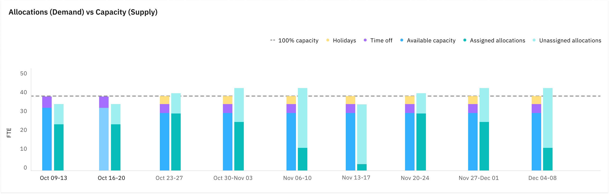
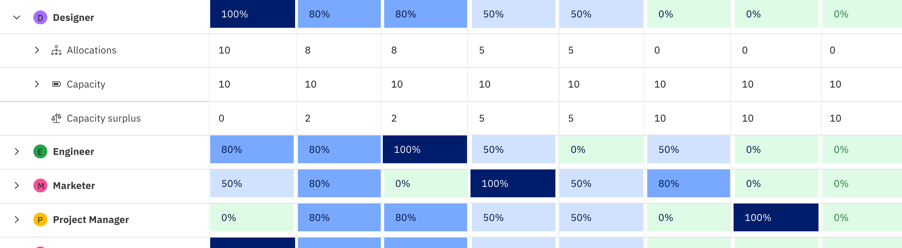
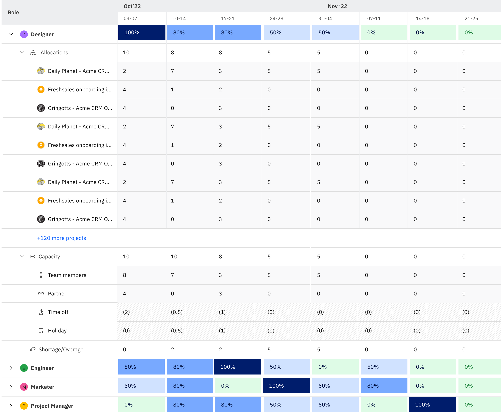

When you're responsible for managing and optimizing resource allocation in your Professional Services (PS) organization, the challenge is to ensure that the demand for your services aligns with your available resource capacity. Rocketlane's Demand vs. Supply report seamlessly acts as a guardrail, aiding in efficient capacity planning within your organization.

**In this article**

- [Significance of FTE in capacity planning:](#Significance-of-FTE-in-capacity-planning%3A)

- [How to read the capacity planning report?](#How-to-read-the-capacity-planning-report?)

  - [Allocation (demand) vs. Capacity (supply) chart](#Allocation-\(demand\)-vs.-Capacity-\(supply\)-chart)
  - [Demand for Roles](#Demand-for-Roles)

- [Using Filters in Capacity Planning](#Using-Filters-in-Capacity-Planning)

Short on time? Catch the video instead!

[Watch video](https://fast.wistia.net/embed/iframe/z5t0e5uk8c?seo=false\&videoFoam=true)

It helps you find the right balance between the supply and demand of resources, equipping you to,

- Determine if your organization has individuals with the right skill sets who are readily available to meet the demand generated by diverse projects. 
- Make data-driven decisions on resource hiring, project prioritization, and resource allocation.
- Forecast future project demands with insights on resource allocations in Full-Time equivalents (FTEs) and ensure you have enough resource capacity for upcoming projects.

## **Significance of FTE in capacity planning:**

**FTE (full-time equivalent)** - is a way to express an employee's workload or the total hours worked by a group of employees in a manner that is easily comparable to a full-time employee. 

Imagine you have a small business with only two employees:

Employee X: Works 20 hours/week.

Employee Y: Works 40 hours/week.

To calculate the FTE for your two employees, you'll use the standard workweek hours, which is set to 40 hours/week (You can set this in Settings -> Preferences) 

FTE = (Total Hours available by All Employees) / (Standard Hours for a Full-Time Employee)

FTE = (20 hours + 40 hours) / 40 hours

FTE = 60 hours / 40 hours

FTE = 1.5

In this example, the combined FTE for your two employees is 1.5. This means that the total capacity of your team is equivalent to 1.5 full-time employees

**Allocations**: The hours allocated across all projects for team members and role-based placeholders determine the demand in FTE.

**Capacity**: This represents the total work capacity available across all your team members, measured in FTE.

**In addition to this, you should also consider:**

**Time Off**: If a team member takes time off, it's important to note that 1 day off is equivalent to subtracting 0.2 FTE from the available capacity. This is taking into account a 5 day work week. 

**Holidays**: Similarly, when a team member has a holiday, it's the same as subtracting 0.2 FTE from the available capacity.This is taking into account a 5 day work week. 

## **How to read the capacity planning report?**

This report aims to help you balance the demand for your services with the available capacity of your resources.

### **Allocation (demand) vs. Capacity (supply) chart**

This chart provides a clear picture of your workforce's capacity with the demands of your organization.  If allocations are consistently higher, you may need more employees. If capacity exceeds allocations, you might be overstaffed. It's a quick way to assess resource balance and efficiency.

****

**100 capacity** is the total capacity of your organization in FTE

**Available capacity** is the real measure of your work capacity after excluding time offs and holidays

**Assigned allocations&#xA0;**&#x63;onsist of allocations assigned to team members in projects.

**Unassigned allocations** consist of allocations assigned to placeholders in projects. Yet to be assigned to a team member. 

### **Demand for Roles**

Demand is measured in relation to the available capacity, indicating the percentage of work capacity currently allocated to projects. This table shows demand for all roles in your company.

**Expand the role to view,**

**Allocations**: for the role across projects. Click to expand the view to see contributing projects. 

**Capacity**: This shows the total available capacity for the role. Click to expand capacity to see team members and partners contributing to the total capacity. Here, the time off and holidays are subtracted from the capacity calculations to give you the total available capacity for that role.

**Capacity surplus** happens when the demand is more than supply and is indicated in FTE, which you can use for your resource hiring needs.

**Using Filters in Capacity Planning**

Filters in capacity planning serve as essential tools to gauge both the existing demand for team skills (Filter Allocations) and the available capacity for additional work (Filter Capacity), aiding in efficient workload management.

**Time Period** - By default, the time period for the report will be “this quarter,” but you can click on the time period and change the duration to your preference. Maximum supported duration is a year. 

**Filter Allocations**: allows you to filter allocations. You can filter these by conditions on projects, roles or team members.  

**Filter Capacity**:  allows you to filter capacity. You can filter this by conditions on team members and roles. 

In this context, "capacity" isn't directly linked to "projects." However, all projects have allocations. Therefore, if you intend to employ "project fields" as filters, you must use both allocation and capacity filters to achieve the desired outcomes.

For example, if you want to know what percentage of the demand for 'consultants' comes from North American projects, then

Filter allocations by Project Region as ‘North America’ and Role as ‘Consultants’ 

Filter capacity by ‘Consultants’ .

> Note: The allocation for archived projects is not calculated during capacity planning
