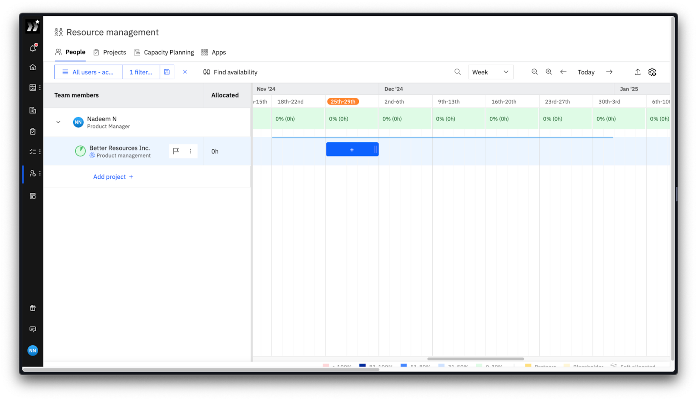
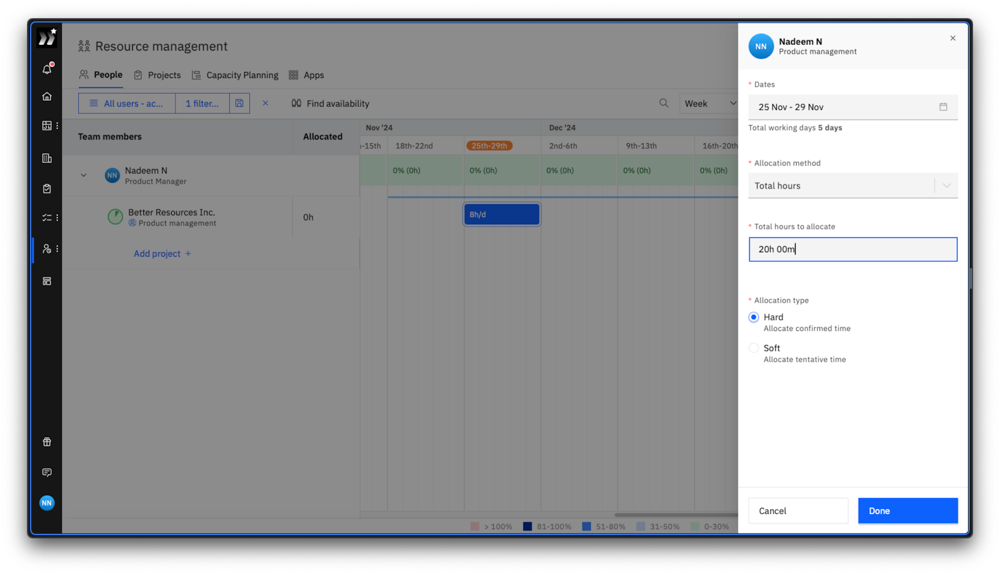
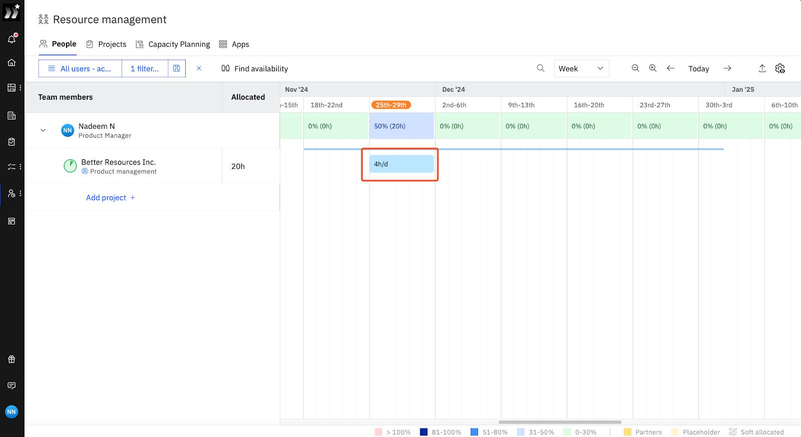
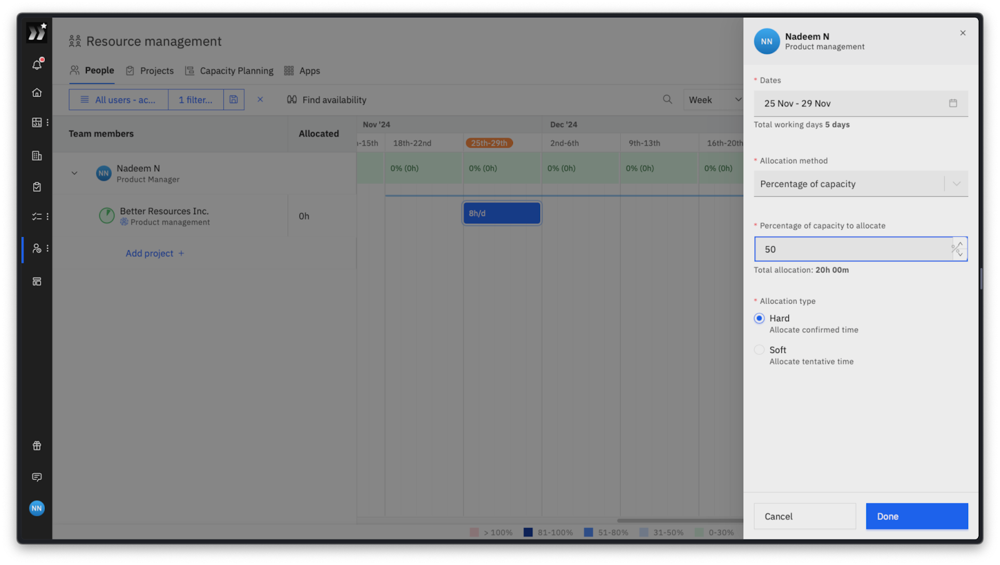
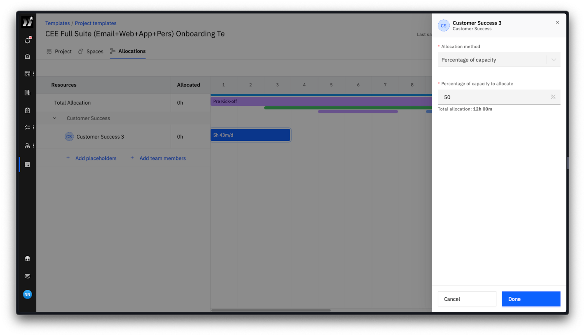
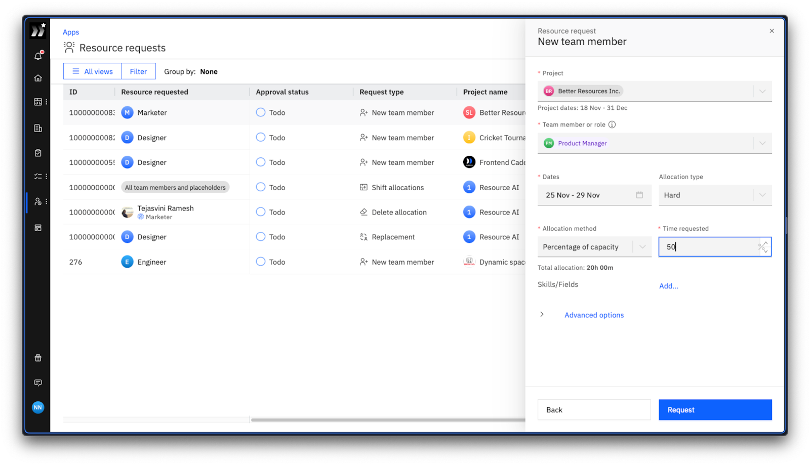
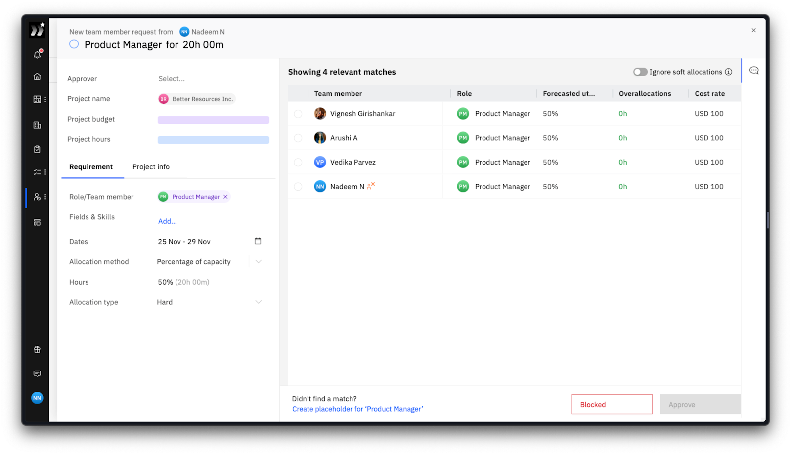
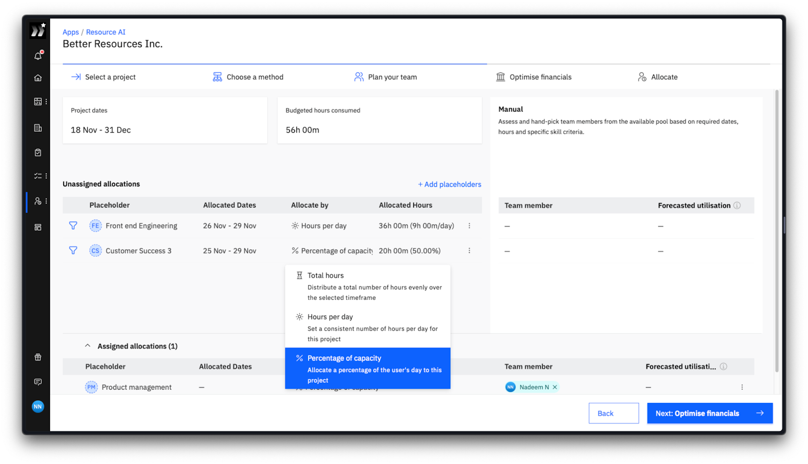

Rocketlane supports **Percentage of Capacity** as a resource allocation method that assigns work based on a percentage of a team member’s configured capacity. This method makes resource management more intuitive, flexible, and aligned with how project managers think about resource allocation. 

**So, what is the percentage of capacity, you ask?**

It is a resource allocation method that assigns work based on a specific percentage of a person’s work capacity within a given period.

For example:

Imagine a team member has an 8-hour work capacity per day based on their Working hours profile. Working hours can include custom work-week schedules, such as a 4-day week. A project manager wants them to dedicate 50% of their time to a particular task. The project manager selects “percentage of capacity” as the allocation method and enters 50%. Rocketlane automatically fetches the team member’s capacity and calculates the exact time allocation per day/week.

> **Note:** The “Percentage of Capacity” method calculates time allocations based solely on a person’s available capacity. It does not account for time-offs or any existing allocations.

### **Why it matters**

Allocating resources based on percentages reduces manual calculations and frequent capacity checks, especially for teams with varying work schedules. The **Percentage of Capacity** method simplifies this process by automatically calculating hours from each team member’s configured working hours and predefined capacity. This method:

- Supports diverse allocation styles.

- Reduces manual calculations.

- Adapts to different capacities across roles and teams.

## **How to set it up**

### **Set Allocation Method**

1. Navigate to **Resource Management > People** or **Projects**.

2. Drag and drop a new allocation.\
   

3. Choose one of the three allocation methods:

   - **Total Hours**: Allocate a total number of hours over a specific period.\
     

   - **Hours/Day or Hours/Week**: Allocate a fixed number of hours per day or week.\
     

   - **Percentage of Capacity**: Allocate a percentage of a person’s daily or weekly capacity (e.g., 50%).\
     

4. Enter the value (e.g., “50%” for capacity).

5. On clicking “Done”, Rocketlane automatically creates an allocation based on your inputs. \
   

> > Note: Percentage allocations use the team member’s configured Working hours to calculate daily or weekly hours. Allocations are always displayed in terms of hours per day or hours per week, regardless of the method used to create them.

## You can switch between allocation methods at any time. The app recalculates the values based on the new method. The last-used allocation method is saved as the default for new allocations.

##

## **Where It Can Be Used**

### **1. Resource Management**

- **People tab**: Allocate resources efficiently across tasks based on capacity.\
  

- **Projects tab**: Distribute workloads dynamically among team members.\
  

### **2. Project Templates**

Define resource allocations in templates using percentages. \

> **Note: When creating an allocation for a placeholder, the capacity defaults to the account-level default capacity used for placeholders.**

### **3a. Resource Requests**

Simplify capacity-based resource requests and approvals. For instance, a request for 50% capacity will reflect the appropriate hours based on the resource’s predefined capacity.\
\
\
**3b. Resource Approvals**

A request approver can see the allocation method used to request a given resource.\

### **4. Resource AI**

Enhance decision-making by leveraging capacity-based insights to optimize resource assignments. Resource AI capacity-based insights also account for configured working hours.\

When planning your team using Resource AI, you can set the allocation method for every placeholder independently. 

## **Example Use Cases**

- **Daily Allocation**: Assign 75% capacity to a resource with an 8-hour day. This automatically allocates 6 hours/day.

- **Weekly Allocation**: For example, allocating 50% capacity for a resource with a 40-hour workweek calculates as 20 hours/week. A resource with a different configured schedule, such as a 4-day week, calculates from that configured capacity.

- **Switching Methods**: Start with a percentage allocation (e.g., 50%), then switch to Total Hours for better granularity as project needs evolve.

This enhancement ensures that resource allocation in Rocketlane is not only more efficient but also tailored to how project managers work, making your projects smoother and more successful.
