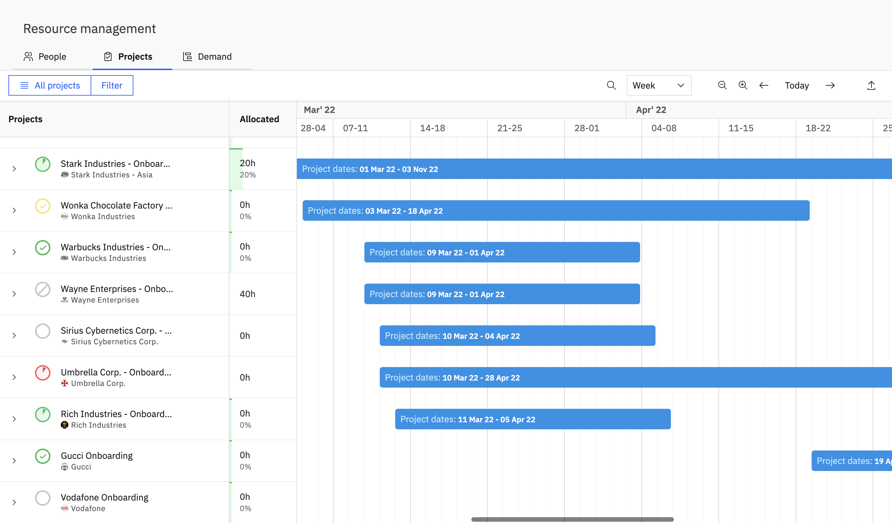
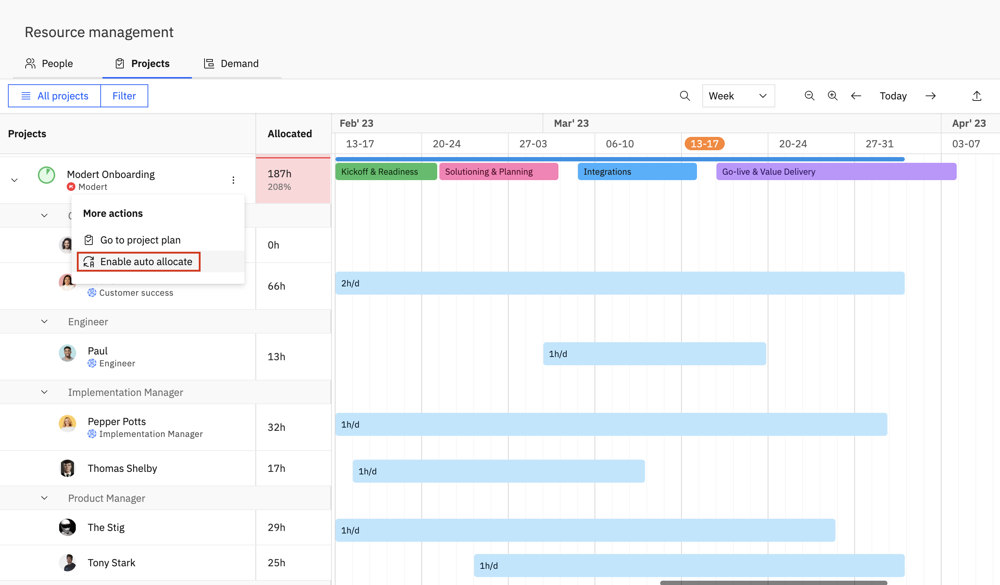
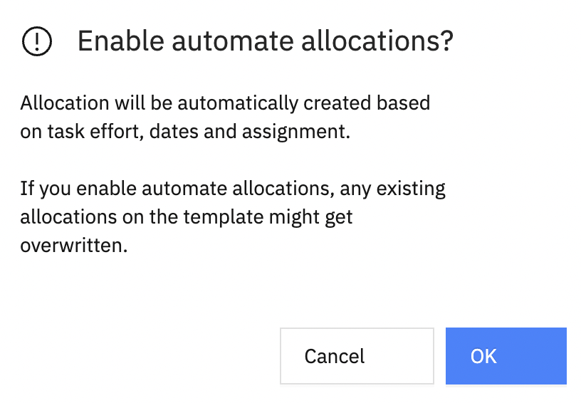
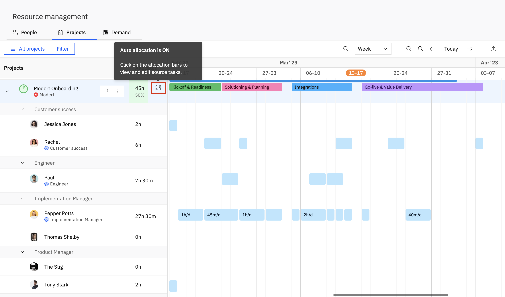
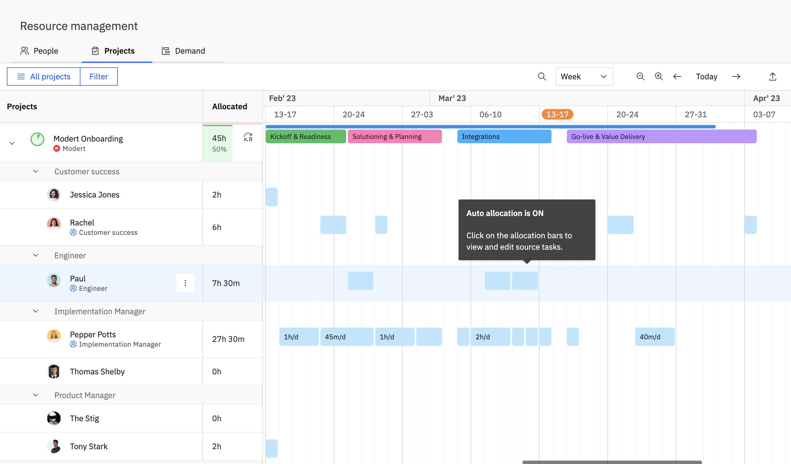
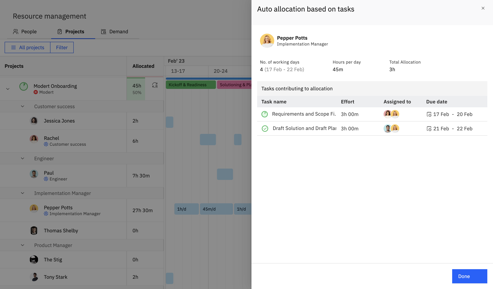

With Auto-allocate, project managers can now incorporate any number of ad hoc changes to the project plan, without worrying about the additional burden of updating resource allocations for every change. With the Auto-allocate feature in Resource Management and Rocketlane Projects, you can define phases, tasks, task duration, the estimated effort required to execute each task, and assign placeholders/ team members for the roles that are required to execute the task. 

When Auto-allocate is turned on for a project, Rocketlane automatically updates the resource allocations when the timelines and/or assignees for a task are modified. For project managers, this means they can add new tasks, remove tasks that have been dropped from the project, move task timelines around, and update task assignees without a second thought. Keeping up with changes to the project scope just got a whole lot easier and hassle-free.

---

## How to Enable Auto-allocate for projects in Rocketlane?

<Callout type="info">
  **_Note:&#x20;_**

  The pre-requisite for enabling auto-allocate for your projects is to define the 

  _duration_

  , 

  _assignees_

   and the 

  _effort_

   fields for tasks.

  \

</Callout>

1. Go to _Resource Management > Projects.\&#xA;_
   <Frame>
     
   </Frame>

2.  Go to the Project that you want to enable auto- allocate for. Go to _More Actions > Enable auto allocate_

   <Callout type="info">
     **_Note:&#x20;_**

     Please take into account that enabling auto-allocate will overwrite any existing allocations, and there is no way to get back your previous allocations.
   </Callout>

   <Frame>
     
   </Frame>

3. Click _OK_ from the confirmation dialog box.
   <Frame>
     
   </Frame>

4. Notice the auto-allocate icon next to the project name indicating that auto-allocate is turned on for this project.
   <Frame>
     
   </Frame>

---

## Editing Allocations Post Enabling Auto-allocate for a Project

Post enabling auto-allocate for a project, the Allocations tab will be available in a read only format wherein you cannot edit the allocation for a placeholder or team member from the timeline view.\
\
<Frame>
  
</Frame>

However, you can click on an allocation and view the source tasks that are contributing to the allocation. 

You can click and go to the tasks from this pane and edit the task properties (_assignees, duration, effort_) to edit allocations for that task.\
\
<Frame>
  
</Frame>

