When managing multiple projects, it is crucial to assign the appropriate resources and skills to each project. However, it can be challenging to achieve this without a clear process in place for demanding and allocating resources to projects, and the right people responsible for executing it.

For instance, project managers may have a good understanding of their own project's requirements, but they may not have clear visibility into the availability of various team members. This is where Rocketlane's Resource Request feature comes in handy.

By allowing project managers to clearly outline their project's resource requirements and providing a central resource management team to oversee the allocation process across all projects, we ensure that the appropriate resources are assigned to each project. This guarantees that projects are allocated the right resources with the necessary skill sets they need to thrive.

This article will teach you how to request resources for projects that require specific skills, and how to allocate and approve the resource requests to optimally use resources in projects.

**Who can raise a request: A user with admin or super user permission can raise the request**

**Who can approve requests: A user with admin or super user permission can approve the request**

> Note: You can specify who can approve resource requests under admin>settings>permissions

# Types of resource requests

When managing a project, it's common to encounter diverse resource allocation needs, each with its own set of unique requirements. The resource request feature has been crafted to address these specific demands enabling you to initiate a request for various staffing purposes such as: 

- Adding a new team member
- Assigning a placeholder, or 
- Allocating additional hours for a resource. 

<Frame>
  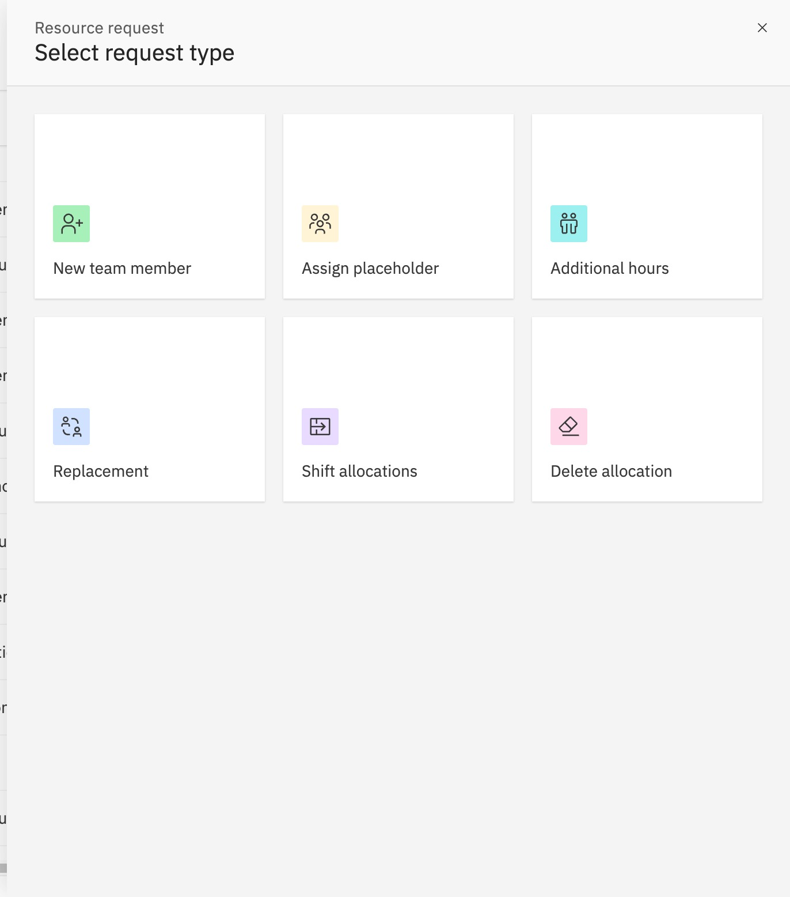
</Frame>

## Add new team member

When you need to request a new team member for a project, it can happen at any stage of the project, whether it's in the planning phase, proposed state, in the pipeline, or elsewhere. When making this request in Rocketlane, you can provide specific details such as the region the resource needs to belong to and the required skill sets. Based on this information, Rocketlane will suggest suitable team members for allocation.

<Frame>
  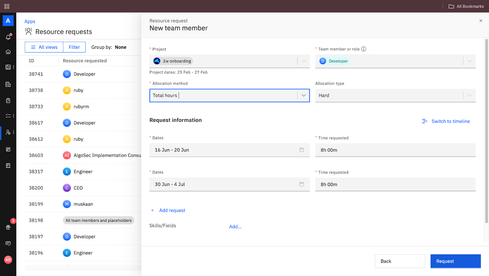
</Frame>

## Add additional hours

During a project, you may require the expertise of specific team members or need increased contributions from certain roles based on the project's progress and client needs. In such instances, Rocketlane allows you to request additional hours to be allocated for particular team members or resources. Additionally, you'll notice an indicator that shows whether the user you're requesting additional hours for is already over-allocated. Over-allocation warnings appear at your organization's configured threshold; by default, warnings appear at 90% of capacity.

<Frame>
  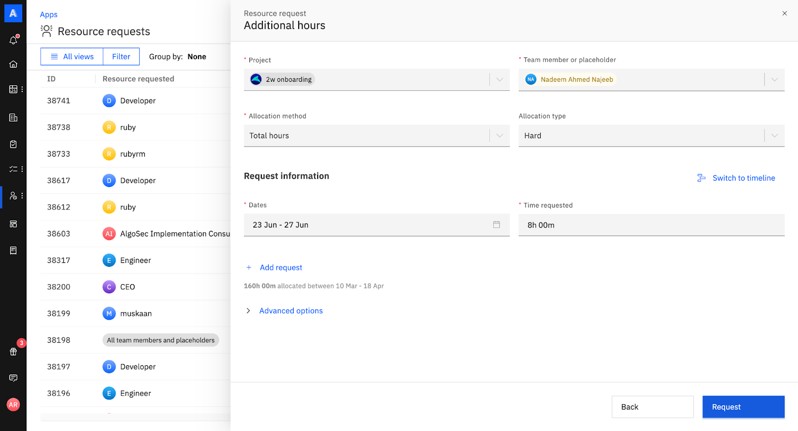
</Frame>

## Assign a placeholder

In Rocketlane, most projects are created from templates that come with pre-assigned tasks to team members. Therefore, when you create a project, you'll notice that most tasks already have assignees. However, if there are any empty or unassigned tasks in your project, it could be because the project was created from a template or a team member couldn't be found earlier.

To assign team members and resolve these unassigned tasks, you can request assistance from the central resource management team. They will help you find a team member to assign to the task and resolve the placeholder in your project.

## Replacement request

You can raise a resource request to replace a team member in a project for any reason. This replacement can be a placeholder or another team member, either for the entire period they were allocated or for a specific time range. If you're selecting a role as the replacement, you can specify the required skills to help the approver find the right match. Please note that replacement requests cannot be made for auto-allocated projects.

###

<Frame>
  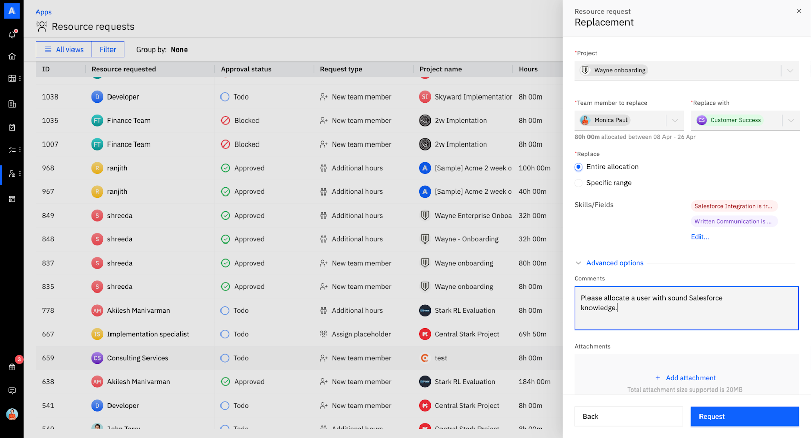
</Frame>

## Shift allocations

This type of request is incredibly useful when you need to postpone a project activity or the entire project. By shifting allocations, you can adjust the allocations for a specific phase or activity, or for the entire project. You can move the allocations for an individual team member assigned to a particular phase or activity, or shift the allocations for all team members involved in the project. Whether you need to reschedule to a specific date or extend the timeline by a few days, this flexibility helps ensure that your project stays on track and accommodates any changes smoothly.

<Frame>
  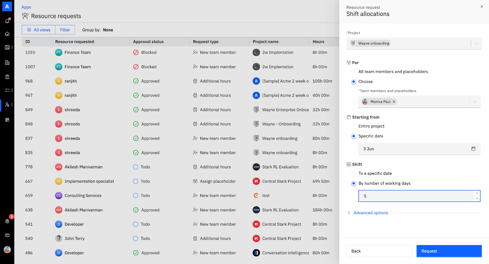
</Frame>

## Delete allocation

If a particular role or team member is no longer needed for an entire project or a specific period, you can easily select the role or team member and specify the time frame during which their allocation is not necessary. Then, you can raise delete allocation requests for their removal from the project.

###

<Frame>
  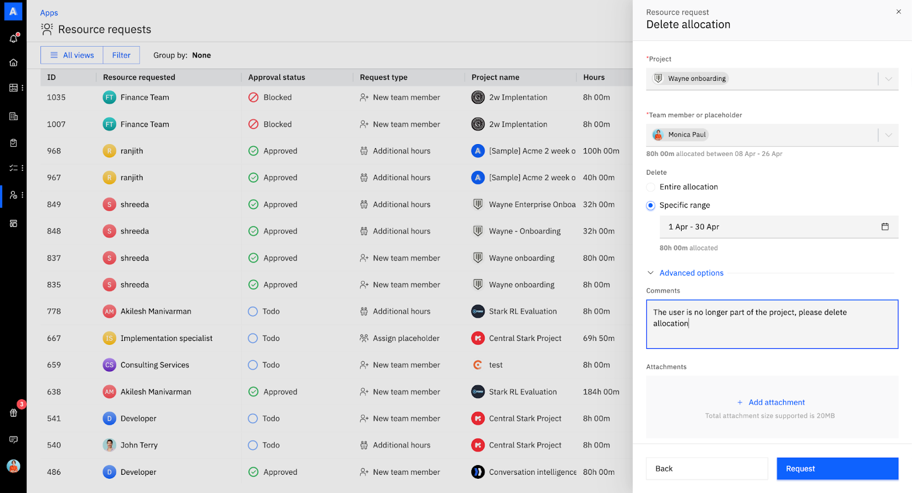
</Frame>

# Raise a resource request

The user making the request should understand the skills and roles needed for the project they require staffing for. For instance, if a project manager knows that their project requires a business consultant with expertise in CRM integrations, an operations manager with financial expertise, and an engineer capable of custom development, they can use the resource request to staff their project.

Resource requests can be raised in two ways: through the **Resource Management** tab or directly within a project.

## Option 1: Raise a Request from Resource Management

1. Navigate to **Resource Management → Apps → Resource Request**

2. Click New Request

3. Choose the type of request:

   - New team member
   - Assign placeholder
   - Additional hours
   - Replace resource
   - Shift allocations
   - Delete allocations

4. Fill in details:

   - Project
   - Team member or role
   - Allocation method and type
   - Dates and requested hours. You can add multiple entries for different time ranges.

5. Use the **Timeline View** toggle to visualize how the request would impact the project’s schedule.

<Frame>
  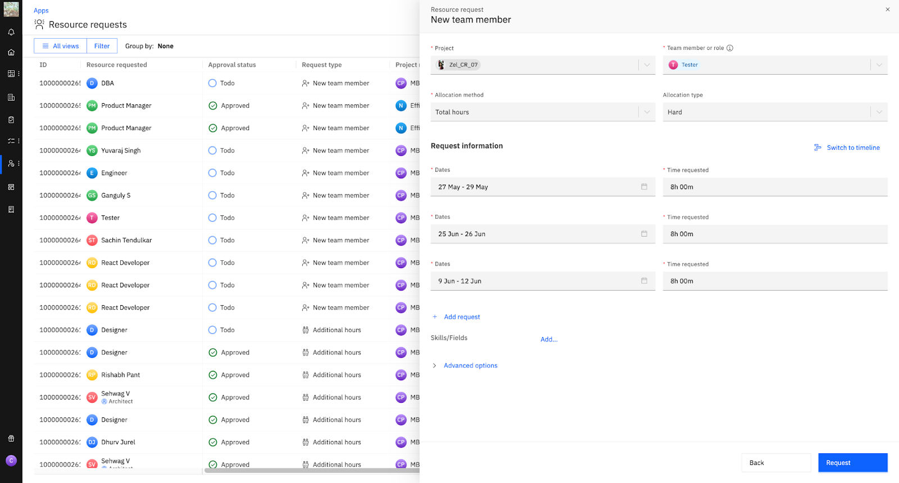
</Frame>

<Frame>
  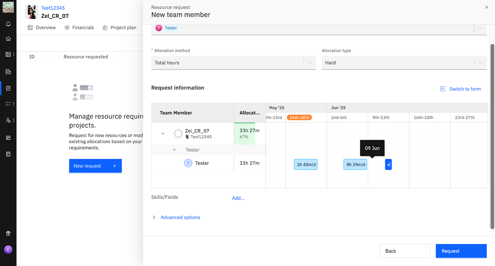
</Frame>

6. Add skills, region filters, and optional context in the comments field.
7. Click **Request** to submit.

## Option 2: Raise a Request from a Project

1. Go to your project
2. Click on the Resource Management tab
3. Select Resource Request

<Frame>
  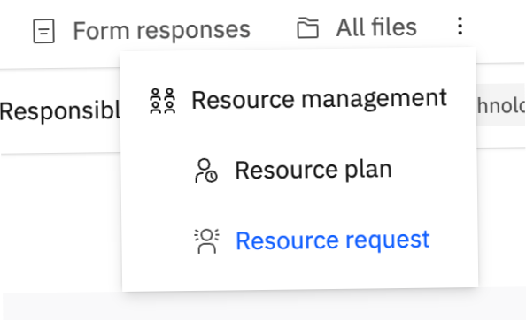
</Frame>

4. Follow the same steps above to fill in and submit your request

\`

# Resource Request List Page:

As a requestor, having a centralized location to view all raised requests for assigning new team members, placeholders, or additional hours is crucial.

<Frame>
  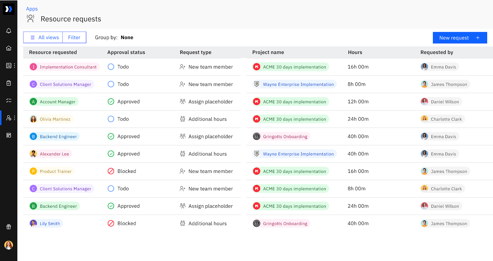
</Frame>

## Checking the status of requests raised in the past:

The resource request list page neatly arranges all requests, showing the most recent ones first. You can easily sort them by clicking on the "requested on" field, which will bring the oldest requests to the top.

## Using filters and grouping requests

You can easily filter the requests based on conditions such as request type, request status or project name and save them as views which you can revisit when resources are assigned/allocated.

Grouping requests based on type, project, date, and status is a great way to track resource request progress.

For example: You can filter projects with the name “Acme” and “ARR” “greater than 10k” and group the requests by type to view all the resources that were blocked.

View and Edit Resource request

You have the option to modify an already submitted resource request. If a request is blocked or if there's a need to adjust the requirements, you can easily edit them.

To edit a request:

- Click on any request in the request list page.
- Select the "edit request" button.
- Add or remove information, skills, or fields as needed.

Click on the "request" button to save your changes.

## Viewing approved requests

After a request is approved, you can locate it by accessing the "resource request list page." Additionally, you can create a custom view for yourself by filtering all approved requests and saving it as a private or shared view.

In order to view the details of a specific request, simply click on the request to open it. You will be able to see all the requirements you mentioned when you raised the request. Once the request is approved, you will be able to see which requirements have been met (denoted by a green tick mark) and which requirements are unmet (denoted by a red warning mark).

<Frame>
  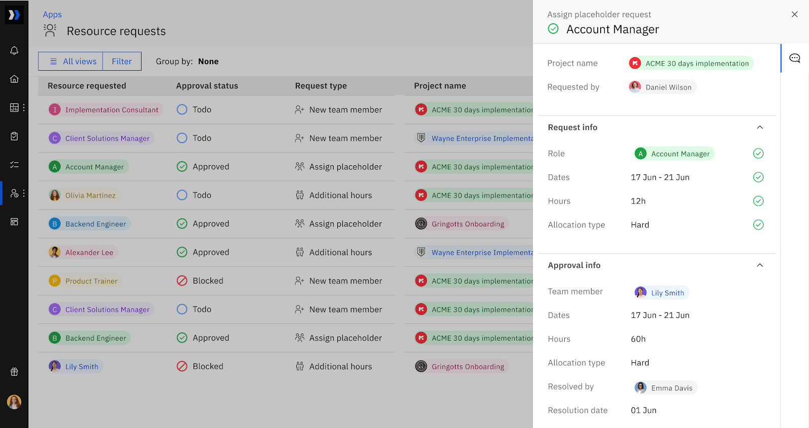
</Frame>

## Viewing blocked requests

If a request is blocked due to over-allocation or unavailability of resources based on certain skills, you can find the blocked requests in the resource list page with a blocked status.

In such cases, you can initiate a conversation using the chat inside the resource request window and edit your request to accommodate another resource.

## Delete Resource Request

To delete a request,

- Select any request in the request list page
- Click on the three dots near the request for more actions
- Click the delete button

# Resource Approval for Approvers

You can specify who can approve resource requests under admin>settings>permissions

## Approve a resource request:

As an approver who assigns resources based on the resource requests received, you can access all resources in a centralized repository. You can filter and group requests based on request type, status, projects, date, etc.

- Navigate to resource management>Apps>Approve a request

- Click on any request to open it where you get the following information:

  - Approver: Assign an approver if one is unassigned.
  - Project name: Name of the project the resource is to be assigned.
  - Project hours: Shows the budgeted, allocated hours, and remaining hours after allocating a resource for the request.
  - Fixed fee/Budget: The allocated budget for the project.
  - Requirement: Contains all the information about the resource requested.
  - Project info: Contains all project-related information.

- In the Approval View:

  - The Timeline view for approvers focuses only on the requested allocations and is scrollable within the requested timeline.

  - When viewing a user’s allocations in the Timeline approval view, all projects with allocations (based on the user’s permissions within the requested timeline) are displayed.

  - Assigning a Placeholder Request for a placeholder with multiple existing allocations in the project defaults to multi-block mode (for both requestor and approver).

  - Users in the approval view are sorted alphabetically by name instead of by user ID.

    <Frame>
      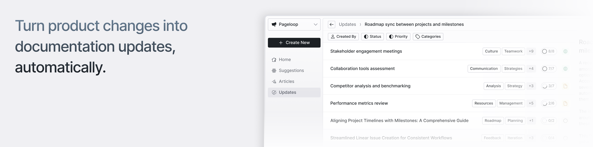
    </Frame>

- Select team member from relevant matches

  - Relevant Matches: Based on the information the requester has added, such as the role you are looking to fill and the skills the resource needs to have, Rocketlane automatically suggests a few team members who will be a good match.

  - Forecasted utilization is calculated as a percentage by taking the total time already allocated for projects and the additional time that is being allocated  It is calculated against the team member's configured **Working hours**, including any custom work-week schedule set in their profile.

  - Overall allocation refers to the total number of hours allocated for the resource if they get assigned to the request.

    <Frame>
      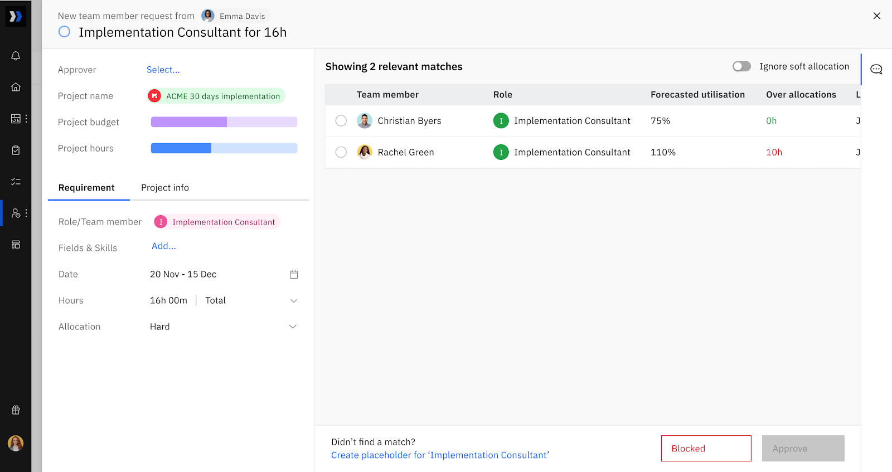
    </Frame>

- Select a team member: 

  - You can choose a team member based on forecasted utilization if they join the project and their over-allocation in hours, if any.
  - Choose the right team member if you found a relevant match, or assign a placeholder in place of a team member if you did not find a match, or block the request with a reason and initiate a chat conversation in the resource request window.

- Ignore soft allocation:
  - If a user's projected allocation is high or the system shows over-allocation warnings, soft allocations may be contributing to the warning. The warning threshold is configurable, and you can switch on the toggle to disregard soft allocations and view the updated figures.

- Edit the request:

  - In cases where the specified requirements are not met, you can check for resources that meet most, if not all, of the requirements by editing the request.
  - If a resource request is edited before assigning a resource, any fields that are edited and not met by the resource will be flagged in red by the system.
  - You can create a placeholder for a request to temporarily allocate an unnamed resource.
  - You can see the Timeline View to understand allocation impact before and after the allocation

## Multiple Approvers for Resource Requests

Resource requests can be configured with more than one approver. This prevents staffing requests from getting blocked when a single approver is unavailable, and ensures approvals can move forward without delays.

### How multi-approver requests work

- One or more approvers can be assigned to a resource request.
- Notifications are sent to all assigned approvers once approvers are assigned.
- Any one approver can take action.
- The first approval or block resolves the request.

### Add multiple approvers manually

In the manual flow, approvers are assigned from the approvals queue after the request is raised.

1. Raise the request from the Resource Request page.
2. Go t&#x6F;**&#xA0;Resource Management → Apps → Approve a request.**
3. Open the submitted request.
4. In the Approver field, select one or more approvers (multi-select).
5. Once added, any approver can open the request and select Approve or Block.
6. The first action taken resolves the request, no further action is required from other approvers.

<Frame>
  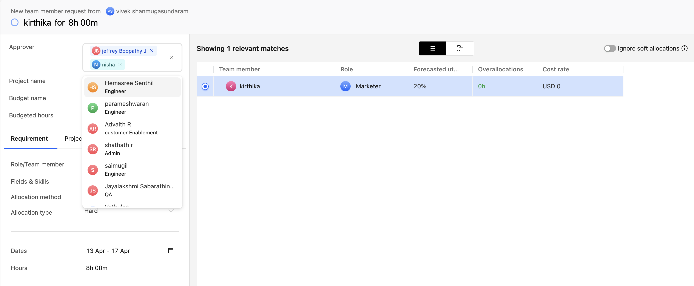
</Frame>

### Assign multiple approvers using automation

Automation rules triggered on resource request creation can assign multiple approvers.

1. Go to Settings → Automations.
2. Select Create automation.
3. Set the trigger to Resource request (on creation/updation).
4. Add the required conditions (optional).
5. Add the action Assign approver and select multiple approvers.
6. Save the automation.

<Frame>
  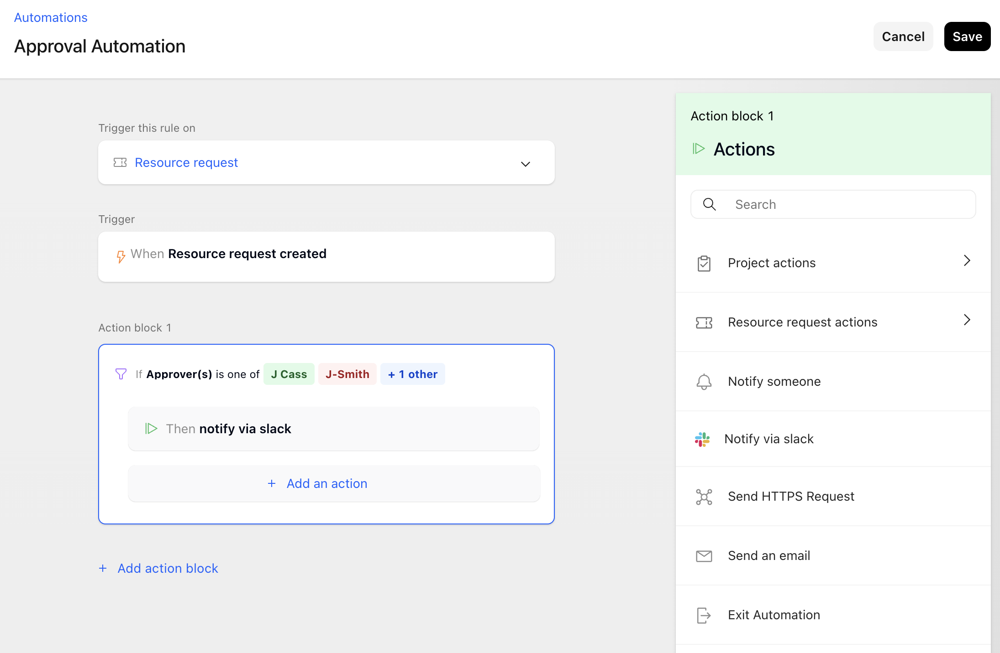
</Frame>

### Approver experience

- Each assigned approver receives a notification when the approvers are assigned.
- Approve or block the request from the approvals view as usual.
- Once one approver acts, the request is resolved and does not require action from the remaining approvers.

## Block a request

If you need to block a resource request because you haven't found the right team member or all suitable resources are over-allocated, you can do the following:

Chat with the requester:

Use the conversation section within the resource request to send a message to the requester and mark the request as blocked.

<Frame>
  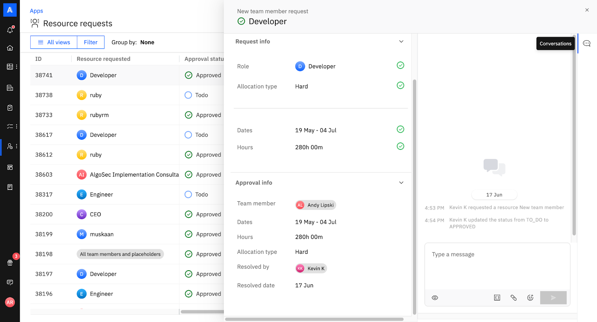
</Frame>

## Filter and view blocked requests:

You can easily filter the blocked requests based on conditions such as request status and save them as views.

Automatically assign approvers to resource requests

With Rocketlane's automations feature you can assign approvers to resource requests once they are raised and also setup conditions that need to be met for the approvers to be assigned.

To do that, 

- Navigate to your avatar as an admin and select settings.
- Scroll down to Advanced settings and select automations
- Create a new automation and choose "Resource request" as the trigger
- Add conditions the automation needs to satisfy such as "Requested by" or "Project name"
- Set the action as "Assign approver" and select approver

<Frame>
  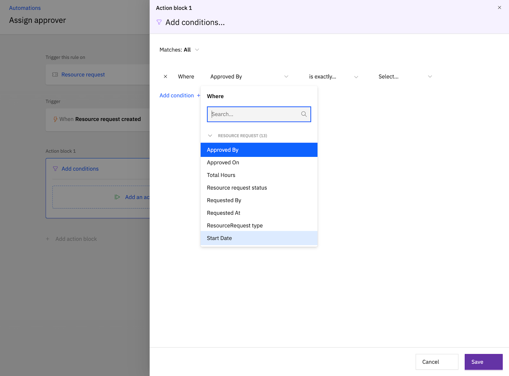
</Frame>

<Frame>
  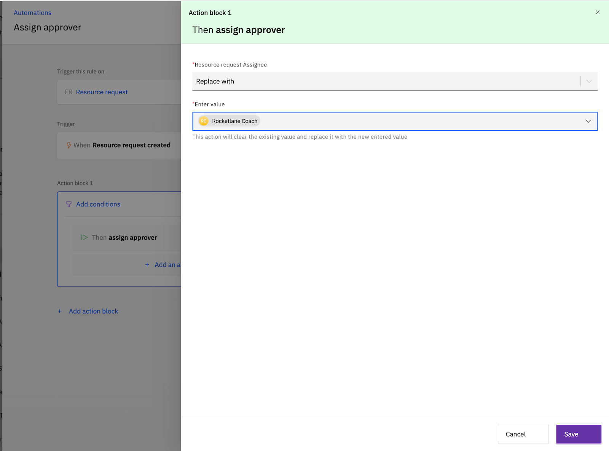
</Frame>
