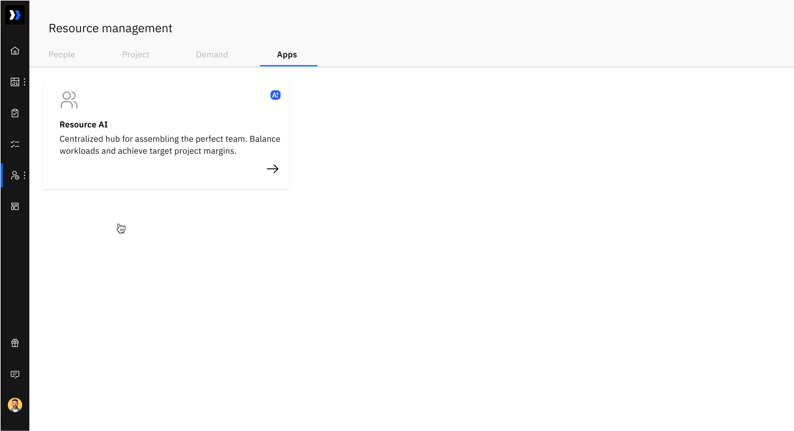
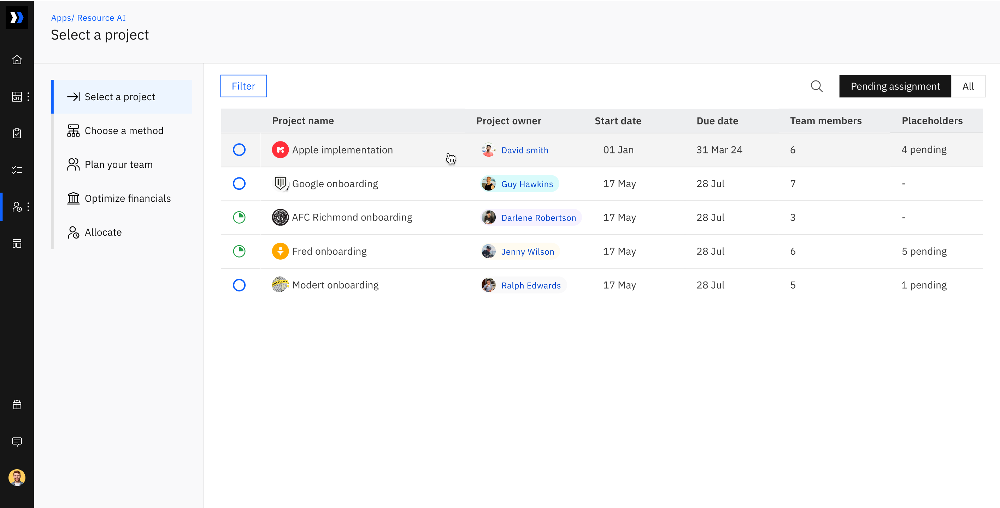
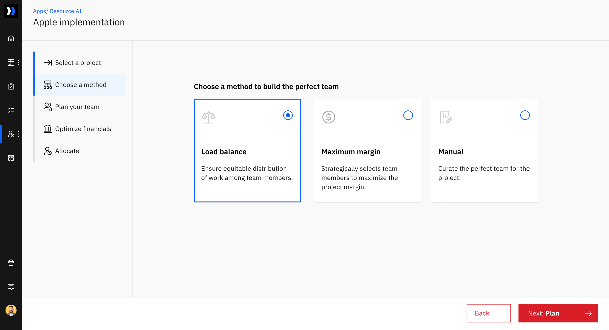
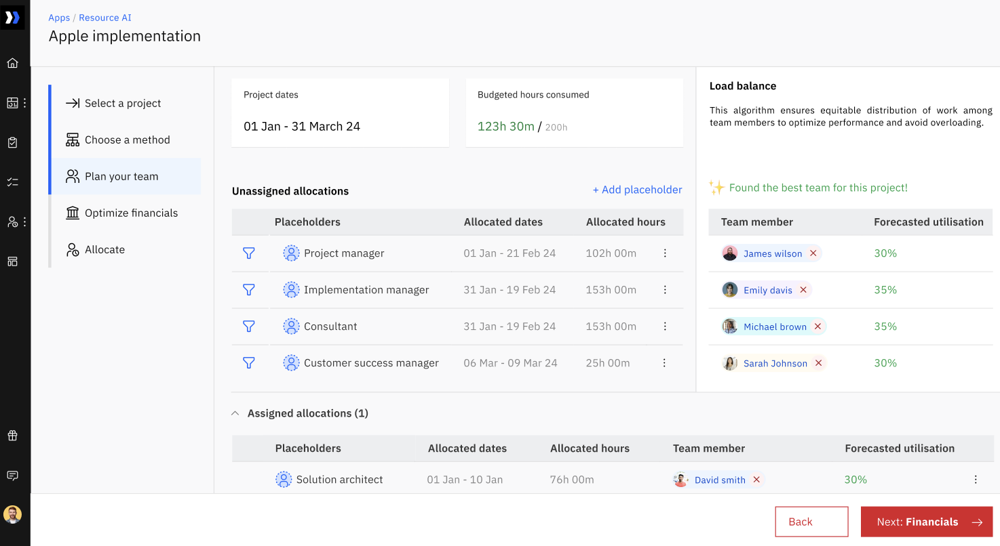
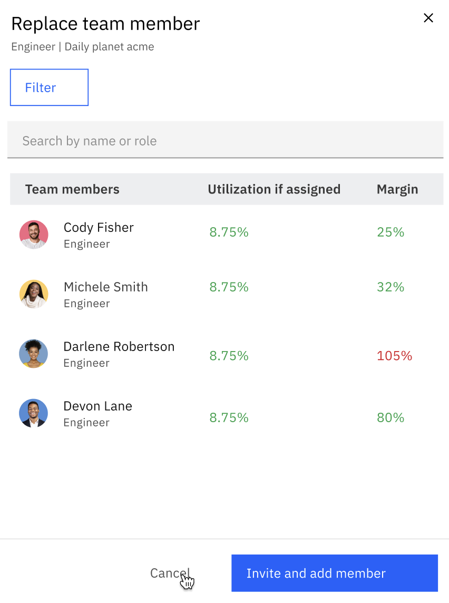
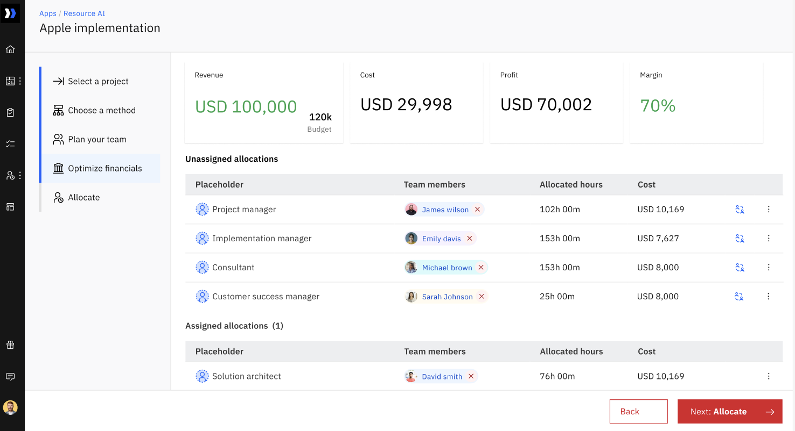
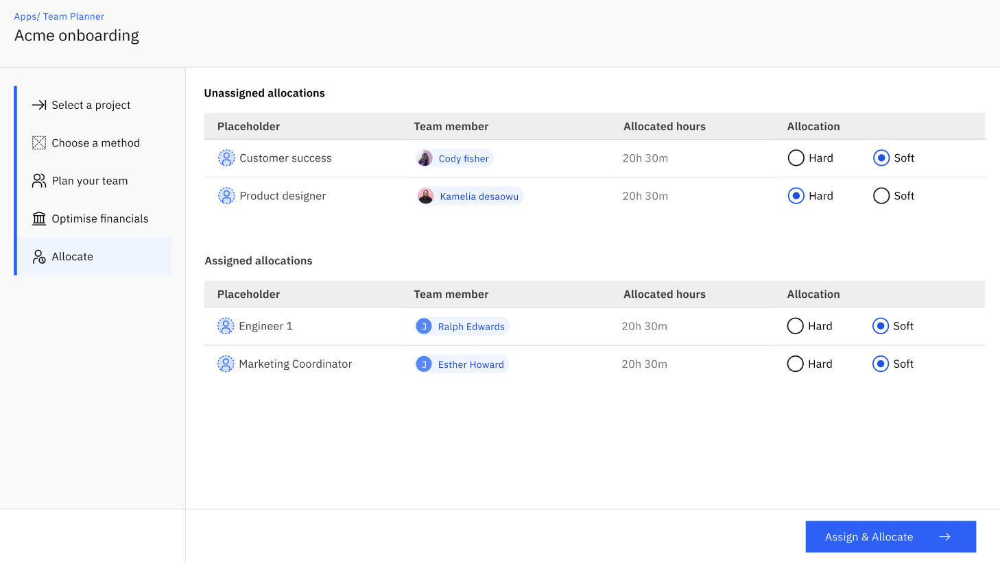

Imagine that you are starting a new project. To ensure its success, you need a team with diverse skills, such as business analysts who can design solutions, consultants who are subject matter experts, and project managers who can organize and execute projects. 

Now, let's assume that you are managing projects across different locations. How can you ensure that the right team members with the perfect skill sets are assigned to your projects while maintaining equitable workload distribution? 

This is where Rocketlane's Resource AI comes in handy. It helps you discover the perfect team that meets your margins while ensuring a balanced workload, all with a simple click of a button.

**In this article**

- [Step 1: Select a Project](#Step-1%3A-Select-the-Project)

- [Step 2: Choose the method](#Step-2%3A-Choose-the-method)

  - [Method 1: Load Balancing: ](#Method-1%3A-Load-Balancing%3A%C2%A0)
  - [Logic behind Load Balance Method](#Logic-behind-Load-Balance-Method)
  - [Method 2: Maximum Margin: ](#Method-2%3A-Maximum-Margin%3A%C2%A0)
  - [Logic behind Maximum Margin Method](#Logic-behind-Maximum-Margin-Method)
  - [Method 3: Manual Allocation: ](#Method-3%3A-Manual-Allocation%3A%C2%A0)

- [Step 3: Plan your team](#Step-3%3A-Plan-your-team)

  - [If placeholders are not allocated](#If-placeholders-are-not-allocated)
  - [If placeholders are allocated](#If-placeholders-are-allocated)
  - [Find the perfect match](#Find-the-perfect-match)

- [Step 4: Optimize financials](#Step-4%3A-Optimize-financials)

- [Step 5: Assign and Allocate](#Step-5%3A-Assign-and-Allocate)

To access Resource AI,

- Login as a&#x6E;**&#xA0;****admin** and navigate to **Resource management**

- Go to the **Apps** tab

- Select the **Resource AI** app

You are four steps away from finding your perfect team!

## **Step 1: Select a project**

In this step, you can find all projects that are awaiting allocations neatly laid out for you. Here, you can choose a project and an algorithm based on which the system can find your perfect team.

- Select &#x61;**&#xA0;project** from the list

- Us&#x65;**&#xA0;filter&#xA0;**&#x74;o get to the project you wish to plan

- Click **next**

## **Step 2: Choose a method**

It's important to establish clear objectives for your team planning efforts. Rocketlane has three distinct methods to assist you in building the perfect project team tailored to the specific needs of each project.

### **Method 1: Load Balancing:&#xA0;**

This approach is about evenly distributing the workload among your available resources.

### **Logic behind Load Balance Method**

For all projects: Team planning is balanced by allocating team members with the least forecasted utilization rates for the allocated dates. 

Utilization is a metric that indicates, for a given date range, the expected level of work commitment for a team member in relation to their total available work capacity.  Forecasted utilization is calculated as a percentage by taking the total time already allocated for projects and the additional time that is being allocated 

For instance, if someone’s work capacity is 40 hours/week and they have 20 hours of work already allocated, plus 12 hours about to be added:

Their forecasted utilization rate would be a percentage of (20+12)/40) = 80%. 

### **Method 2: Maximum Margin:&#xA0;**

As the name suggests, this method will optimize for team selection in a way that ensures maximum possible margin for your project given the requirements.  

### **Logic behind Maximum Margin Method**

**For fixed fee projects**: Maximum margin planning will pick the team members with a lower cost rate.

**For Time and Material projects**: The system will pick the team member with  the most profit margins. Profit margin for team members is calculated based on their bill rates (taken from the rate card) and cost rates

For instance, if someone’s bill rate is 100$ and cost rate is 70$:

Margin would be percentage of (100 - 70)/100 = 30%

> Note 1: For T\&M projects, the project should have a rate card to calculate margins.

> Note 2: The algorithm will skip the team member with the least cost rate or the maximum margin, if  their forecasted utilization is greater than  100%

### **Method 3: Manual Allocation:&#xA0;**

Allows you to handpick team members for specific roles keeping in mind their utilization rates and margins.

## **Step 3: Plan your team**

This is a crucial step where Rocketlane assembles the ideal team for your project based on the planning method you chose. 

The prerequisites to curate a team are, 

1. Role based placeholders

2. Allocated dates and 

3. Allocated hours.

### 

###

### **If placeholders are not allocated**

- Click the “add placeholder” button and select a placeholder

- Select the date range under allocated dates

- Add the allocated hours for the placeholders

- Resource AI will automatically find you the right resource to replace the role based placeholder. For example, if you chose “consultant” as the placeholder, it can be replaced by “Rachel” who is the consultant available for the selected time period.

### **If placeholders are allocated**

If you have allocated placeholders, date and hours in your resource management settings, it gets carried over to Resource AI and the system finds you the best resources who can replace the placeholders for the allocated time period. 

Here is where you can decide to stick with the suggested team or make adjustments as needed to create your perfect team!

### Find the perfect match

You can make changes to the team curated by Rocketlane if 

1. No match was found by Rocketlane for the planning method you chose

2. You wish to replace a team member

- Click on the no match found button or remove the existing team member and tap to open the find team member dialog box

- Use filters to narrow down the team members you wish to allocate

- Click "Reorder" to sort team members by utilization or margins.

- Click the radio button next to the selected team member

- Click add to add or replace team member

Note: Click more actions near the placeholder to remove it

## **Step 4: Optimize financials**

This section is accessible only if you have turned on Financial Management for your account. 

For T\&M and Fixed fee: It gives you an overview of the [revenue, profit, cost, and margins ](https://help.rocketlane.com/support/solutions/articles/67000721452-understanding-financial-numbers-for-time-and-material-projects)you will make with this resource plan. 

For Non billable: It gives the[ cost ](https://help.rocketlane.com/support/solutions/articles/67000721454-overview-of-non-billable-projects)utilized for this resource plan.

You can either accept the team that Rocketlane finds you if it aligns with your financial margins or make changes to the team to best suit your finance goals using the “Replace team member” icon.

- Click replace team member

- Make the necessary changes, click assign and allocate

- You can see live changes to your financial data as you make changes

- Click Allocate 

## **Step 5: Assign and Allocate**

- **Determine the allocations as hard or soft for all team members**

- **Click Assign and Allocate&#xA0;**

**\&#xA;**

****

**\&#xA;**

**By gaining a solid understanding of these resource allocation methods and maintaining visibility into your team's utilization rates, you'll be well-prepared to streamline your resource planning, make informed decisions about who should work on what, and ultimately achieve better profit margins.**

**\&#xA;**

**\&#xA;**

**\&#xA;**
