# Resource Management

Resource Management helps you to efficiently plan, schedule and allocate resources for your projects. You can manage projects, allocate resources or placeholders, look into resource demands,  check for over allocation and under allocation.\
\
By keeping a tab over the work hours of your team members, you can ensure that resources are better allocated with a balanced load sharing model where no one is under/ over worked. Comapring project timelines and resource availability helps you to churn results faster and with efficiency.

# How to Access Resource Management?

You can access Resource Management by clicking on Resource Management icon from the vertical left navigation bar.\
\
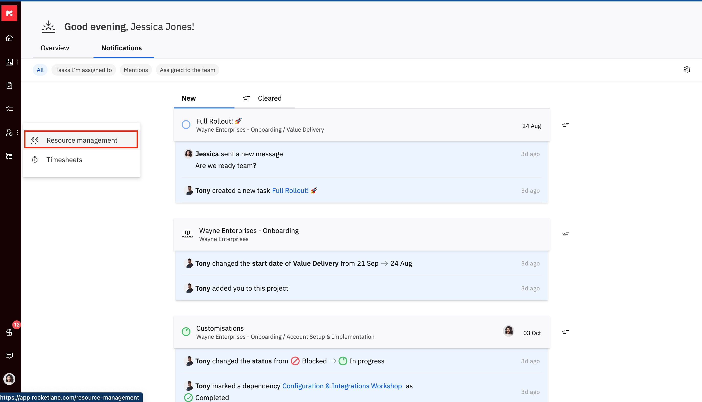

# Resource Management: The People Tab

Using the _People_ Tab i&#x6E;_&#xA0;Resource Management_, you can find the perfect set of people for your projects. The find availability feature automatically provides suggestions to show available resources. \
\
The _Filter_ feature lets you look for specific people based on roles, departments, skills and much more.\
\
Add _allocations_ to project timelines with extremely easy user interface which allows you to edit, drag, drop and split timelines!

## 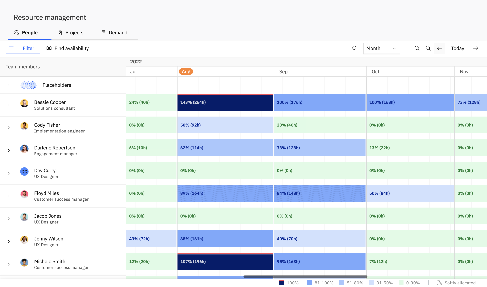

##

## People Tab: The Timeline View

**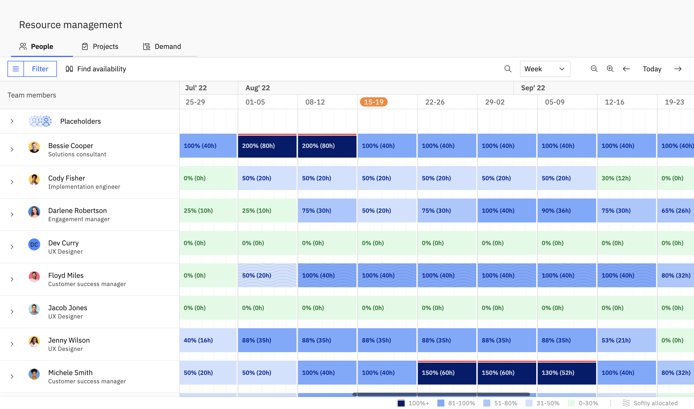**

You can view how occupied &#x61;_&#xA0;team member_ is by looking at the timeline corresponding to it. The timeline bar next to each _team member_ has a percentage value indicating how occupied that _team member&#xA0;_&#x69;s.

The timeline bars are colour coded according to the degree of allocation for ease of viewing.

<Frame>
  
</Frame>

There is an additional red line over each timeline bar apart from the colour coding to indicate over allocation

<Frame>
  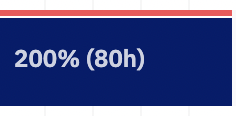
</Frame>

<Callout type="info">
  _**Note:**_

   By default, each

  __&#xA0;Team member&#xA0;__

  has a bandwidth of 

  _8_

   hours per day.
</Callout>

Hover over a _team member's_ timeline bar to view the hover panel with total capacity and allocation details. The _Hard Allocations_ and _Soft Allocations_ breakdown is displayed as a stacked bar instead of separate percentage values.

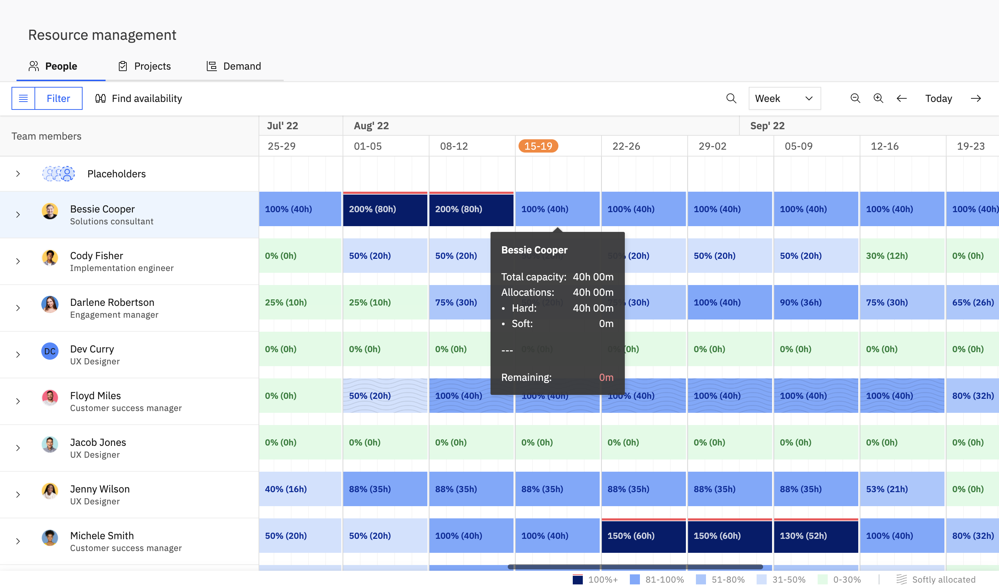

<Callout type="info">
  __**Note:**__

   The timeline uses the 

  _Weekly_

   view by default. You can change your default time-span view in 

  _Settings > Preferences_

  . Depending on the time span view you choose, the bandwidth summary varies based on the daily, weekly, and monthly timeline allocations.
</Callout>

**Total Capacity:&#xA0;**\
\
Indicates the total number of hours a _team member&#xA0;_&#x69;s available for based on the current time span view you are in. \
\
You can view &#x61;_&#xA0;team member's&#xA0;_&#x64;aily, weekly and monthly capacity.

**Hard Allocations:**\
\
Indicates the confirmed allocated hours for the _team member._ In the hover panel, hard allocations appear as segments in the stacked bar breakdown.

**Soft Allocations:**\
\
Indicates the number of tentative allocated hours for the _team member.&#xA0;_\
\
The soft allocations are denoted in the timeline view by using a different pattern to indicate it has not been finalised. 

<Callout type="info">
  _**Note:**_

   Soft allocations are denoted using a pattern on the timeline bar.

  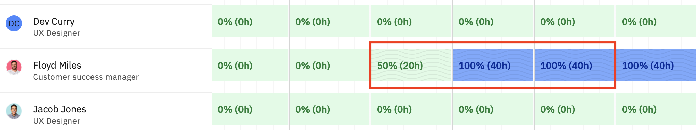
</Callout>

**Remaining:**

Indicates the number of unallocated hours remaining out of the total bandwidth for the _team member._ In the hover panel, remaining capacity is shown alongside the stacked allocation breakdown.

##

##

## Adding Allocations for a Team Member

1. To start adding allocations for _team member_, click on the _team member's&#xA0;_&#x61;ccount name from the _Team members&#xA0;_&#x63;olumn. \
   \
   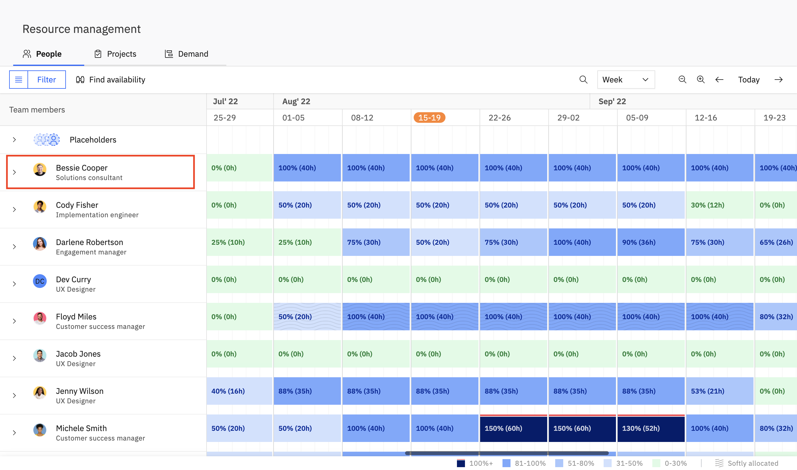

2. Click on '__Add project'__  in case you want to allocate th&#x65;_&#xA0;team member&#xA0;_&#x74;o a new project.\
   \
   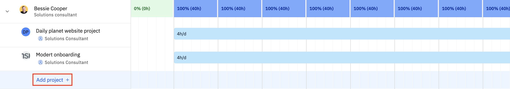

3. After adding the team member to the project you can assign allocations to the _team member_ by adding a timeline bar next to the _team member_ for the corresponding dates.\
   \
   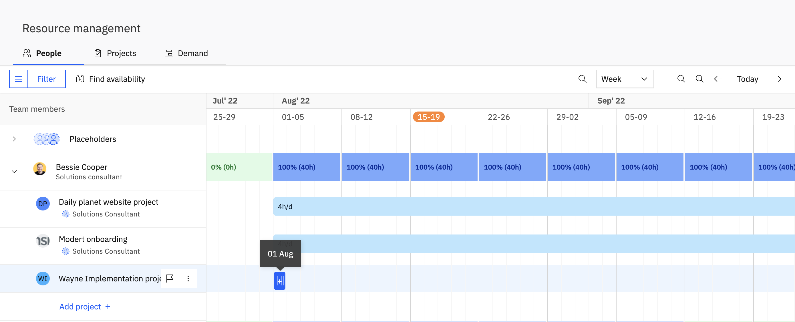

4. As soon as you add an allocation for a _team member_ on the timeline, a panel opens on the right side of the screen.  \
   \
   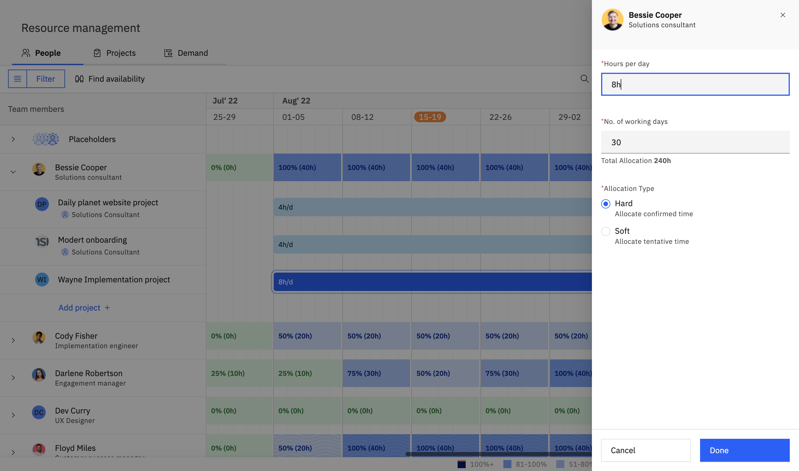\
   You can edit these fields from this panel:

   - _**Hours per Day:**_ Define the number of hours per day the _team member_ is required for in the _project_.
   - _**Number of Working Days:**_  Displays the total number of working days for which that _team member_ is required for in the _project_.
   - _**Allocation Type:**_ Choose the type of allocation based on the conformation status of the _project_ and the _team members.&#xA0;_\
     \
     __'Hard allocation'__ is for confirmed allocations and '__Soft allocation'__ is for tentative allocations.

5. Click _Done_ to save changes.

## Editing Allocations

For already existing allocations, you can increase/ decrease the total number of working days by expanding/ contracting the timeline bar from both ends.

You can shift the timelines for each allocation by dragging and dropping the timeline bar to the new dates.

Click on the timeline bar and edit the allocation properties from the panel on the right. \
\
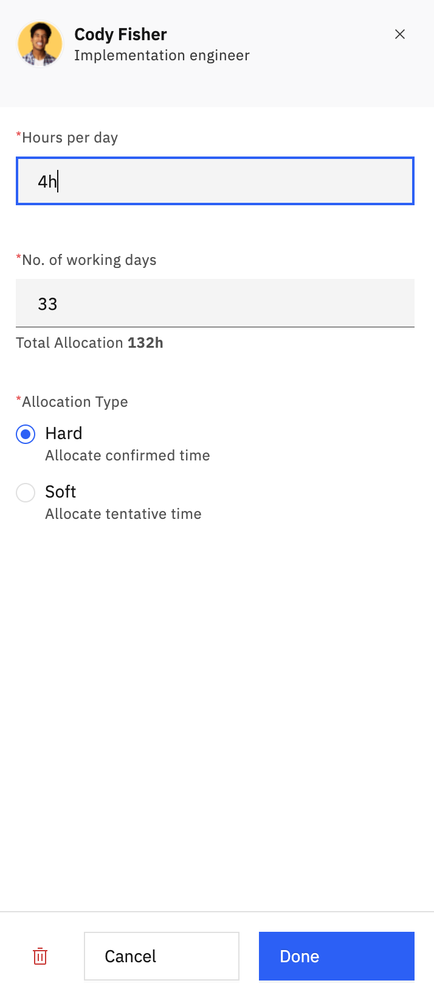

You can edit these fields from this panel:

- _**Hours per Day:**_ Define the number of hours per day th&#x65;_&#xA0;team member_ is required for the _project_.
- _**Number of Working Days:**_  Add the total number of working days for which the _team member_ is required for th&#x65;_&#xA0;project._
- _**Allocation Type:**_ Choose the type of allocation based on the conformation status of the _project_ and th&#x65;_&#xA0;team members.&#xA0;_\
  \
  __'Hard allocation'__ is for confirmed allocations an&#x64;__&#xA0;'Soft allocation'&#xA0;__&#x69;s for tentative allocations.

You can also delete the allocation from here by clicking on the _delete_ button at the bottom of the dialog box.

## More Actions for allocations

Click on the '__More actions'__ icon from the right most corner of the timeline bar. \
\
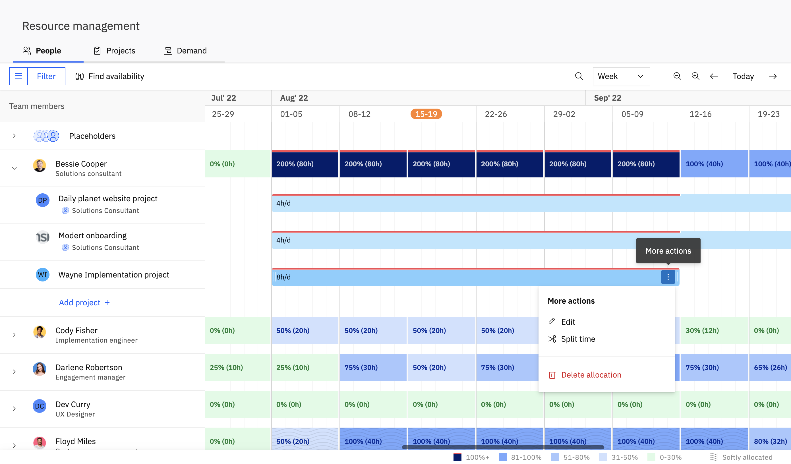\
\
\
You can perform the following actions from here:

- **Edit**\
  \
  Clicking on this opens the allocations edit panel on the right where you can edit the hours per day, number of working days and the allocation type. \
  \
  You can also delete the allocation from here.
- **Split Time**\
  \
  In cases where a _team member&#xA0;_&#x69;s required for different number of hours for different _project_ _phases_, you can use the split time feature.\
  \
  On clicking _Split Time_, the timeline bar is split evenly at regular intervals and cursor turns into a scissor. You can choose to split the bar into two parts by clicking on the interval where you want to split.
- **Delete Allocation**\
  \
  Click to delete the allocation

<Frame>
  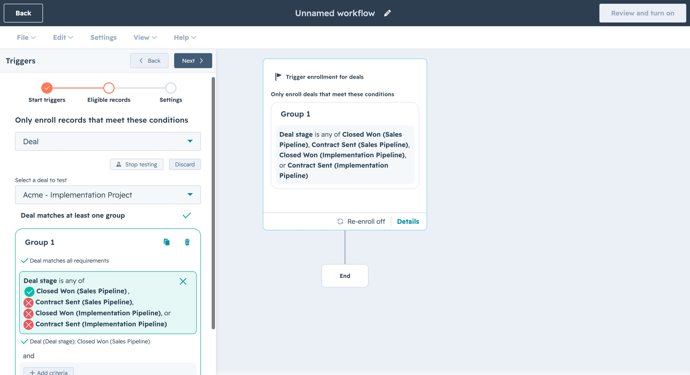
</Frame>

Hey! Here's hoping that this support document was useful. You can write to us at [care@rocketlane.com](mailto:care@rocketlane.com) in case of any queries.
