**TABLE OF CONTENTS**

- [Resource Management](#Resource-Management)

- [How to Access Resource Management?](#How-to-Access-Resource-Management?)

- [Resource Management: The Projects Tab](#Resource-Management%3A-The-Projects-Tab)

  - [Projects Tab: The Timeline View](#Projects-Tab%3A-The%C2%A0Timeline-View)
  - [Adding allocations to a Project](#Adding-allocations-to-a-Project)
  - [Enabling Auto Allocate for a Project ](#Enabling-Auto-Allocate-for-a-Project%C2%A0)
  - [Manually Adding Allocations for a Resource in a Project](#Manually-Adding-Allocations-for-a-Resource-in-a-Project)
  - [Editing Allocations](#Editing-Allocations)[More Actions for allocations](#More-Actions-for-allocations)

---

## Resource Management

Resource Management helps you to efficiently plan, schedule and allocate resources for your projects. You can manage projects, allocate resources or placeholders, look into resource demands,  check for over allocation and under allocation.\
\
By keeping a tab over the work hours of your team members, you can ensure that resources are better allocated with a balanced load sharing model where no one is under/ over worked. Comparing project timelines and resource availability helps you to churn results faster and with efficiency.

# How to Access Resource Management?

You can access Resource Management by clicking on Resource Management icon from the vertical left navigation bar.\
\
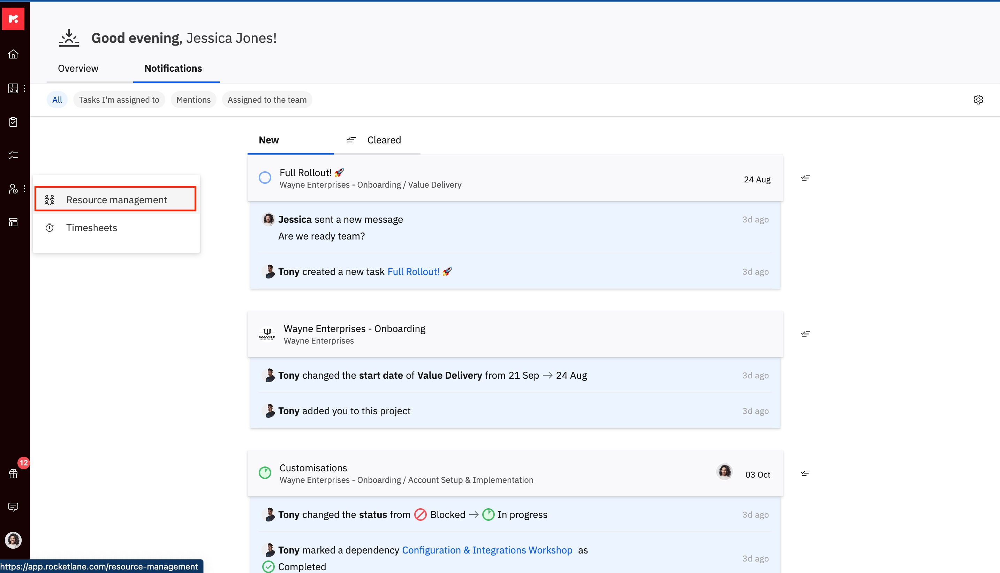

# Resource Management: The Projects Tab

Rocketlane gives you a timeline view of all your projects. You can click on any project to see all the members working on that project, along with their roles and the time allocated to each member.

Make the most of your employee’s time without burning them out. Effectively plan your team’s capacity to ensure balanced workloads while maximising utilisation. Enable your project managers to commit timelines with confidence based on your team’s available capacity.

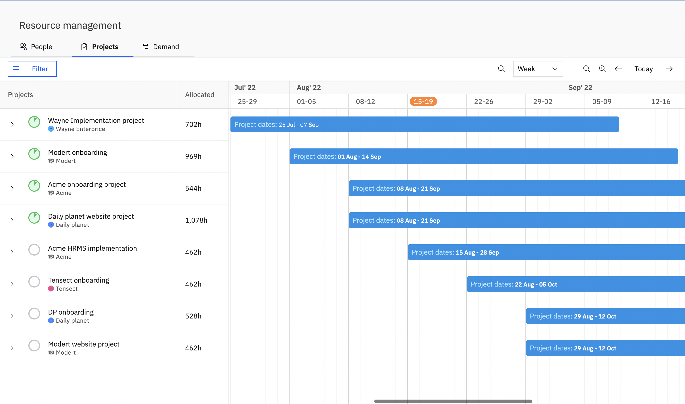

## Projects Tab: The Timeline View

Rocketlane gives you a timeline view of all your projects. 

<Frame>
  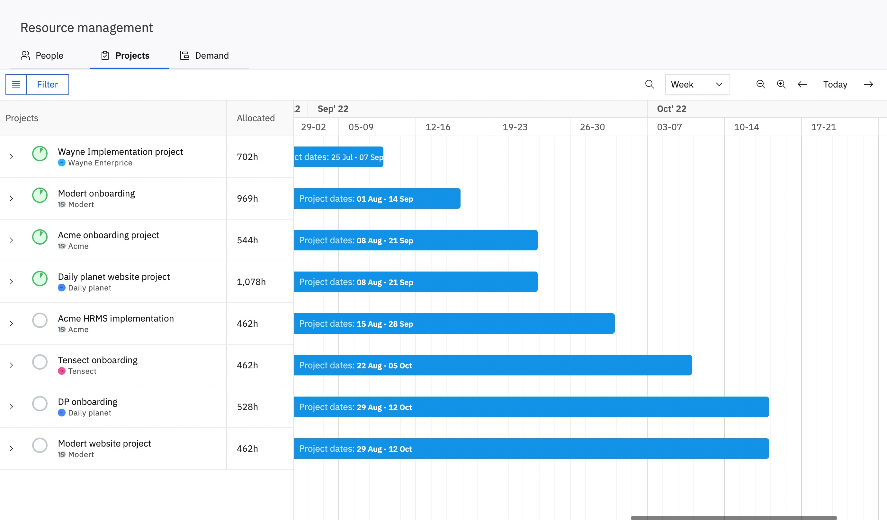
</Frame>

You can click on any project and view the project phases displayed across the timeline so that you can have a better look at phase timelines too.\
\
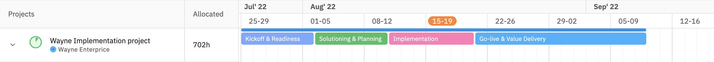\
\
You can click on any project to see all the members working on that project, along with their roles and the time allocated to each member.\
\
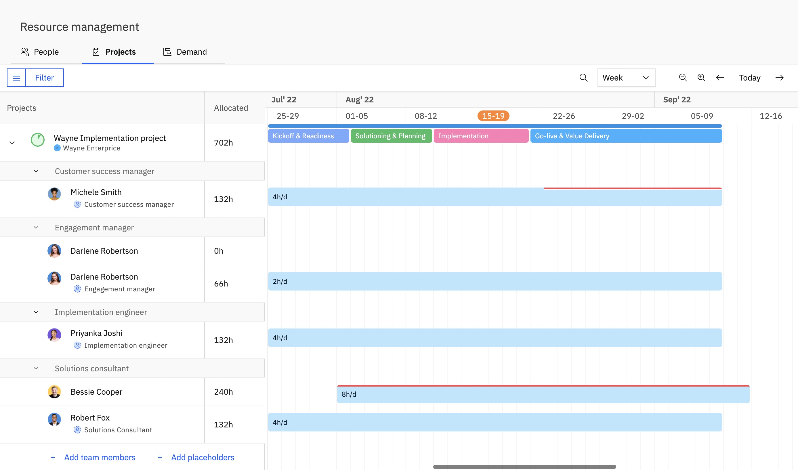

The timeline bars for each team member display the number of hours per day allocated to the member for that project.

<Callout type="info">
  **Note:**

   You can edit the weekly team capacity by going to
</Callout>

Hover over the timeline bar for a team member and you will see a bandwidth summary for that team member with respect to that project.\
\
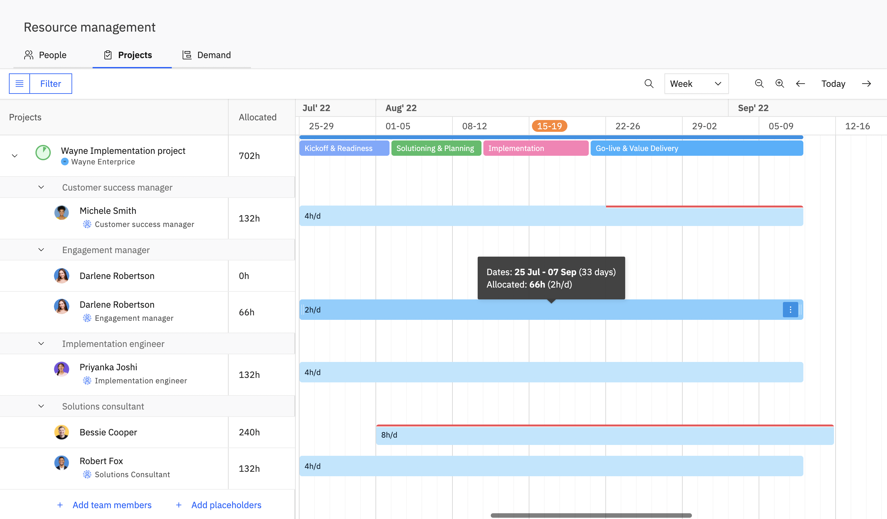\
**Dates:&#xA0;**

Indicates th&#x65;_&#xA0;Start date_ and _End date_ for the allocation. The total number is days is mentioned in parentheses.

**Allocated:** 

Indicates the total number of hours for the allocation. The number of hours per day allocated to the team member is mentioned in parentheses.

<Callout type="info">
  _**Note:** Over-allocation warnings appear when allocations meet the configured warning threshold. The default threshold is 90% of capacity. Organizations can configure this threshold in Settings > Resource Management._
</Callout>

## Adding allocations to a Project

You can add allocations for placeholders as well as team members in a project in Rocketlane. This can either be done manually or you can enable auto allocate for automatically allocating the resources based on the effort, duration and assignees updated at a task level in the project.

##

## Enabling Auto Allocate for a Project 

Click on the link next to read more about how to enable auto allocations for a project: [How to Enable and Configure Auto-allocations in a Project?](https://help.rocketlane.com/en/support/solutions/articles/67000716122)

## Manually Adding Allocations for a Resource in a Project

1. You can add allocations for existing team members in a project or add a new team member and then allocate. Add a new team member to a project by clicking on '__Add team members'&#xA0;__&#x66;rom the projects column.\
   \
   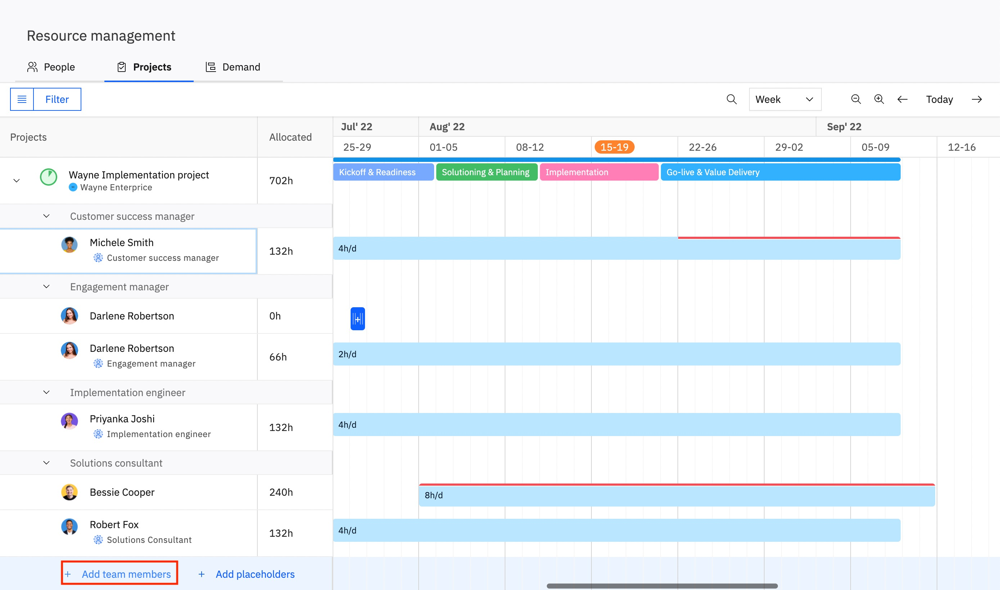

2. After adding the _team member_ to the project you can assign allocations to the _team member&#xA0;_&#x62;y adding a timeline bar next to the _team member_ for the corresponding dates.\
   \
   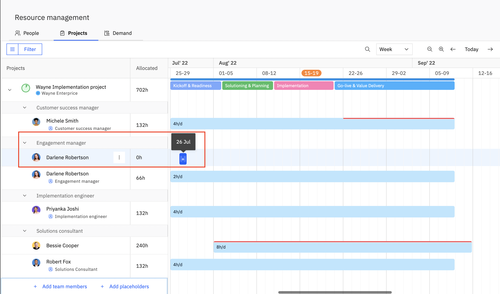

3. As soon as you add an allocation for a team member on the timeline, a panel opens on the right side of the screen.  \
   \
   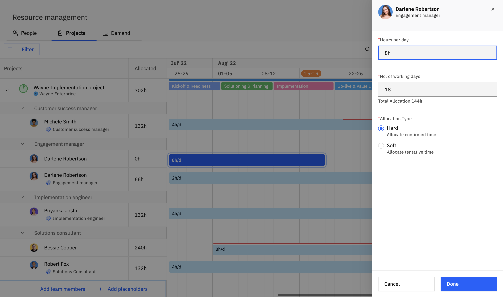\
   \
   You can edit these fields from this panel:

   - **Hours per Day:** Define the number of hours per day the team member is required for the project.

   - **Number of Working Days:** 

   - **Allocation Type:** Choose the type of allocation based on the conformation status of the project and the team members. \
     \
     Hard allocation is for confirmed allocations and Soft allocation is for tentative allocations.

- <Callout type="info">
    _**Note:**_

     Soft allocations are denoted using a pattern on the timeline bar.

    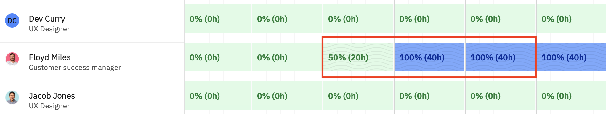
  </Callout>

1. Click _Done_ to save changes.

## Editing Allocations

For already existing allocations, you can increase/ decrease the total number of working days by expanding/ contracting the timeline bar from both ends.

You can shift the timelines for each allocation by dragging and dropping the timeline bar to the new dates.

Click on the timeline bar and edit the allocation properties from the panel on the right. 

<Frame>
  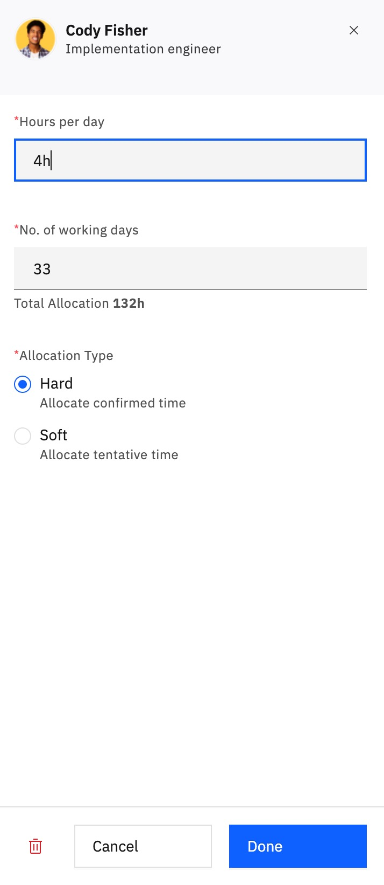
</Frame>

You can edit these fields from this panel:

- **Hours per Day:** Define the number of hours per day the team member is required for the project.
- **Number of Working Days:**  Add the total number of working days for which that member is required for the project.
- **Allocation Type:** Choose the type of allocation based on the conformation status of the project and the team members. \
  \
  Hard allocation is for confirmed allocations and Soft allocation is for tentative allocations.

You can also delete the allocation from here by clicking on the _delete_ button at the bottom of the dialog box.

## More Actions for allocations

Click on the _'More actions'_ icon from the right most corner of the timeline bar. \
\
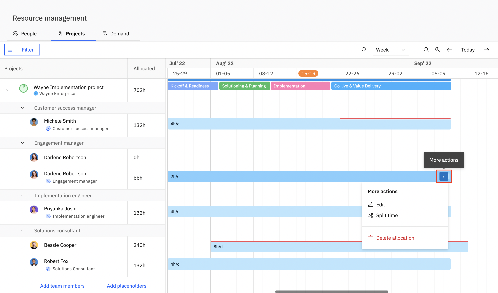

You can perform the following actions from here:

- **Edit**\
  \
  Clicking on this opens the allocations edit panel on the right where you can edit the hours per day, number of working days and the allocation type. \
  \
  You can also delete the allocation from here.
- **Split Time**\
  \
  In cases where a team member is required for different number of hours for different project phases, you can use the split time feature.\
  \
  On clicking _Split Time,_ the timeline bar is split evenly at regular intervals and cursor turns into a scissor. \
  \
  You can choose to split the bar into two parts by clicking on the interval where you want to split.
- **Delete Allocation**\
  \
  Click to delete the allocation.

Hey! Here's hoping that this support document was useful. You can write to us at [care@rocketlane.com](mailto:care@rocketlane.com) in case of any queries.
