# Resource Management

Resource Management helps you to efficiently plan, schedule and allocate resources for your projects. You can manage projects, allocate resources or placeholders, look into resource demands,  check for over allocation and under allocation.\
\
By keeping a tab over the work hours of your team members, you can ensure that resources are better allocated with a balanced load sharing model where no one is under/ over worked. Comparing project timelines and resource availability helps you to churn results faster with efficiency.

# How to Access Resource Management?

You can access Resource Management by clicking on Resource Management icon from the vertical left navigation bar.\
\
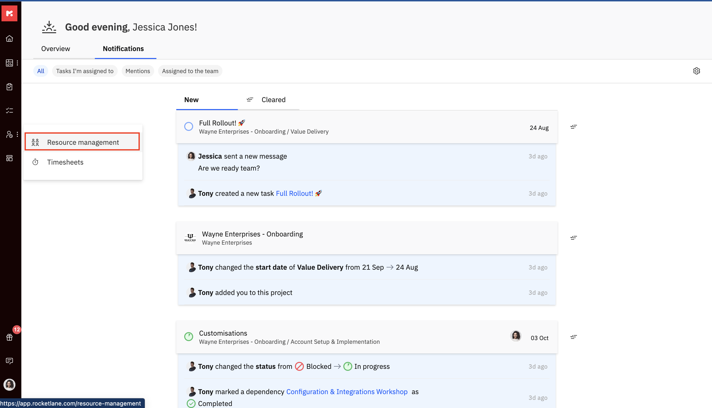

# Resource Management: The People Tab

Using the __People__ Tab i&#x6E;__&#xA0;Resource Management__, you can find the perfect set of people for your projects. The find availability feature automatically provides suggestions to show available resources. \
\
The __Filter__ feature lets you look for specific people based on roles, departments, skills and much more.\
\
Add __allocations__ to project timelines with extremely easy user interface which allows you to edit, drag, drop and split timelines!

## 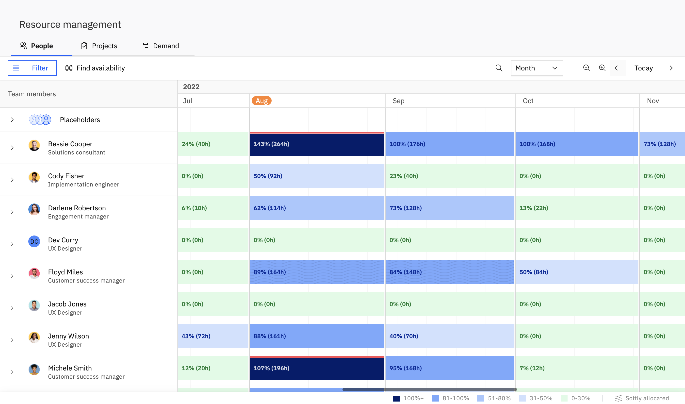

##

People Tab: Menu Bar Options\
\
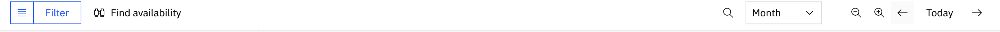
---------------------------------------------------------------------

### **Filter** &#xNAN;**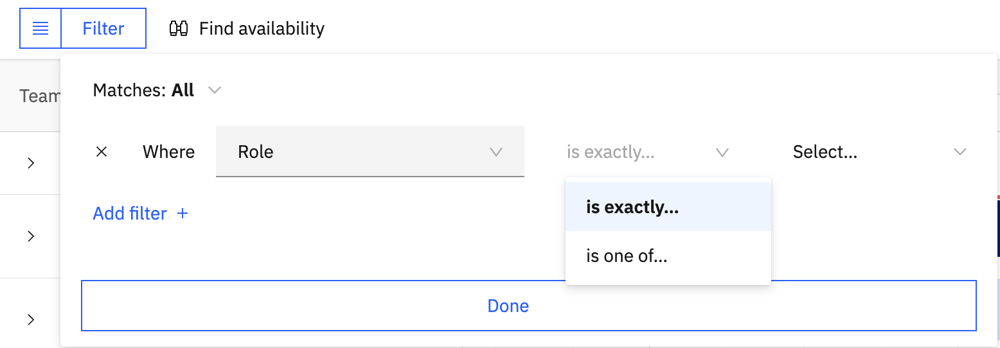**

The filter feature helps you to filter team members or roles according to your requirements.

- __**Matches:**__**&#xA0;**\
  \
  The matches selection has two options namely __All__ and __Any__. \
  \
  Select __All__ in case you want to match all the filter conditions to be set. \
  \
  Select __Any__ in case you want to display results for any one filter condition that matched.\
  \
  \
   
- __**Where:**__ \
  \
  You can select specifi&#x63;__&#xA0;Team Members__ or __Roles__ that you want to filter.\
  \
  \
   
- __**Add Filter:**__ \
  \
  You can add multiple filters.

Click __Done__ to apply the filter conditions.\
\
Click __Clear__ to exit the filter mode.

 

### **Saved Views**

Recurring filters can be saved as views for ease of access. To save a filter as a view click on __Save view as.__\
\
In the __New View__ dialog box, give a name to the view. You can choose to make the view private or public. Click __Save__ to save the view.\
\
To display your view click on the __Saved Views__ Hamburger icon next to filters.\
\
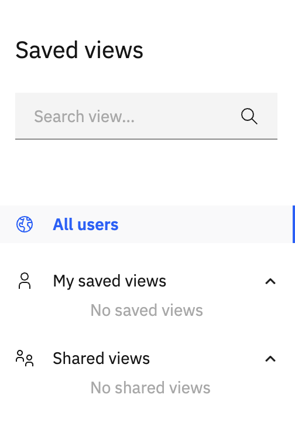

- __**All Users:**__ Takes you to the default view without any filters applied.\
  \
   
- __**My Saved Views:**__ Lists the __Saved__ views marked as private.\
  \
   
- __**Shared Views:**__ Lists the __Shared__ views marked as public.

###

### **Find Availability**

The __Find Availability__ feature allows you look for team member's availabilities based on roles, for a specific time and required hours per day.\
\
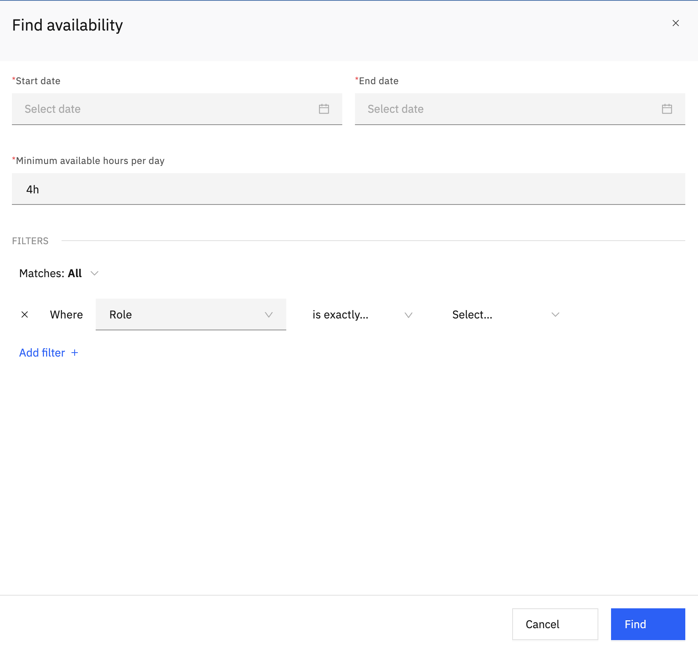

Click __Find__ after selecting __Start date, End date and Minimum number of hours per day__ and applying additional __filters__.

You view __Focus mode__ wherein the availability of the team members is blurred for the rest of the timeline view except for the time duration you chose.

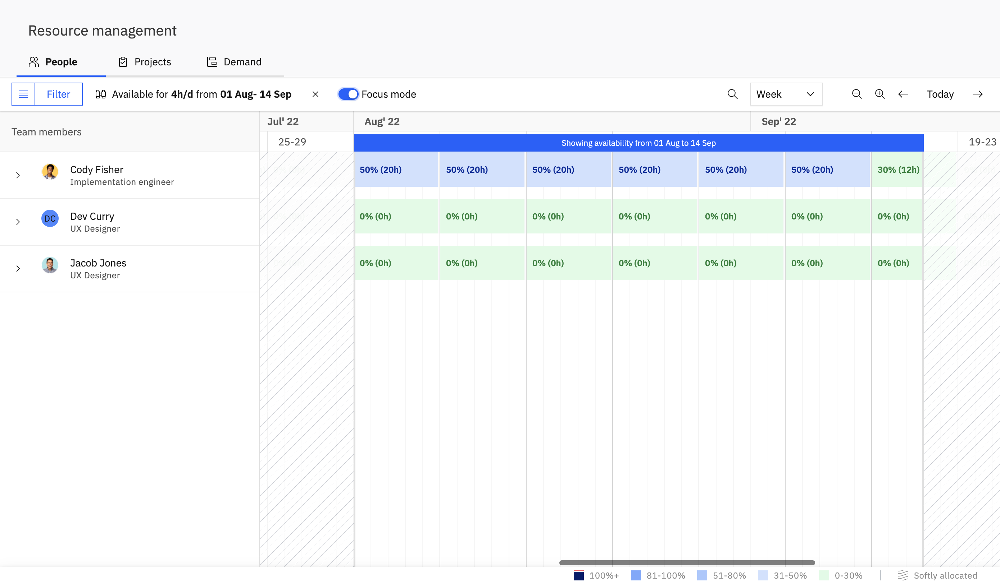

There is a __Focus mode__ toggle button which helps you to enter and exit __Focus mode.__

 

__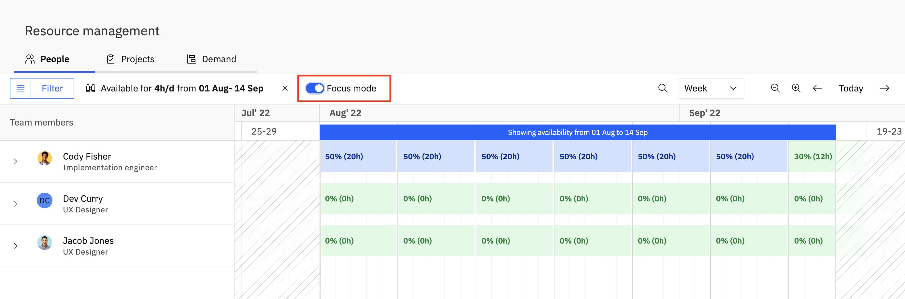__

To exit the __Find availability__ mode, click on the __'Clear selection x'__ button next to the selection dates.

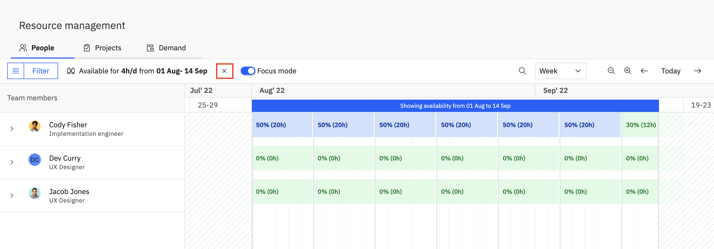

###

### **Search**

The __Search__ button helps you to look for specific __Team members.__

### **The Month, Week and Day Views** &#xNAN;**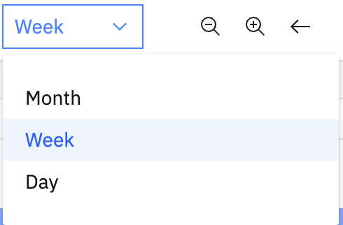**

You can change the view by switching between the time spans that you want to see on the timelines. Switch between __Month, Week__ and __Day__ views.

### **Zoom in and Zoom out**

This filter lets you maximise/ minimise the view and automatically changes timespans between __Month, Week__ and __Day__ view.

### **Previous/ Next timespan**

Allows you to move to the previous/next timespan based on the level of zoom that you are currently on and your current viewing window size.

### **Today**

Clicking on the __Today__ button brings you back to the current date on the timeline.

##

## People Tab: The Team Members Column

### The __Team members__ column next to the timeline lists all the team members in your account.  

### **Go to start of Project** &#xNAN;**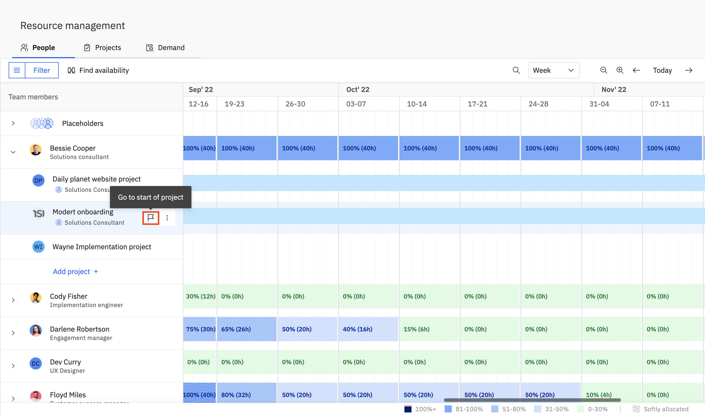**

Clicking on the '__Go to start of project'__ icon takes the timeline view to the start date of the corresponding __project__.

 

###

### **Remove team member from project**

To remove a __Team member__ from a specific __project__, click on th&#x65;__&#xA0;Team member's&#xA0;__&#x6E;ame and go to the __project__. Click on __More actions > Remove from project.__\
\
__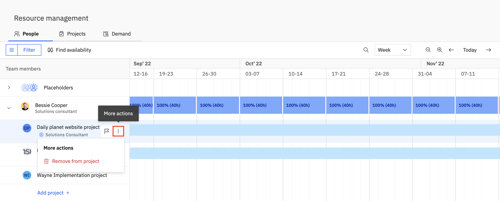__\
\
A warning message pops to ask if you really want to remove the __team membe____r__ from the __project__. Click __Remove__.\
\
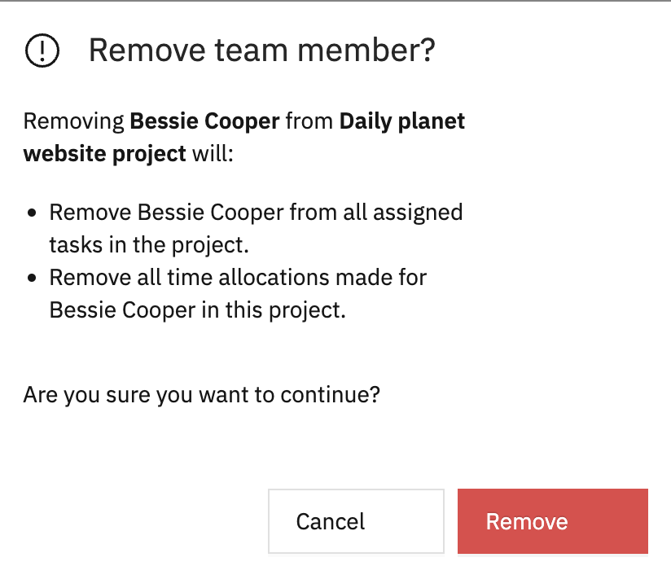

 

### **Placeholders**

In cases when the projects are in planning or when you are not sure about the exact team members who will be a part of a project, you can still add __Placeholders__ and replace those with actual __Team members__ later.

Click on __Placeholders__ to view the list of all placeholders. The number next to each placeholder indicates the number of projects that need team members to be allocated.\
\
\
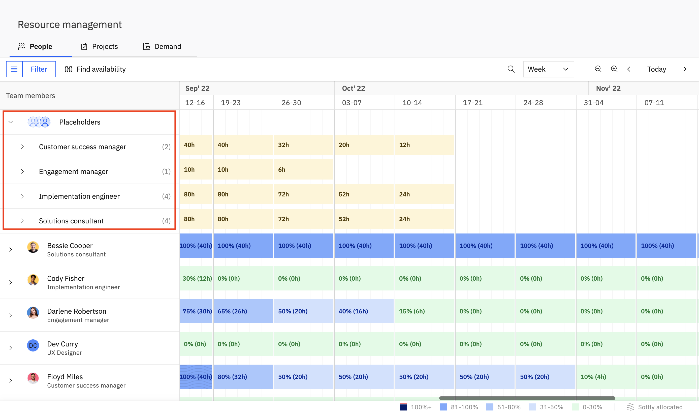

### **Find Team Member** &#xNAN;**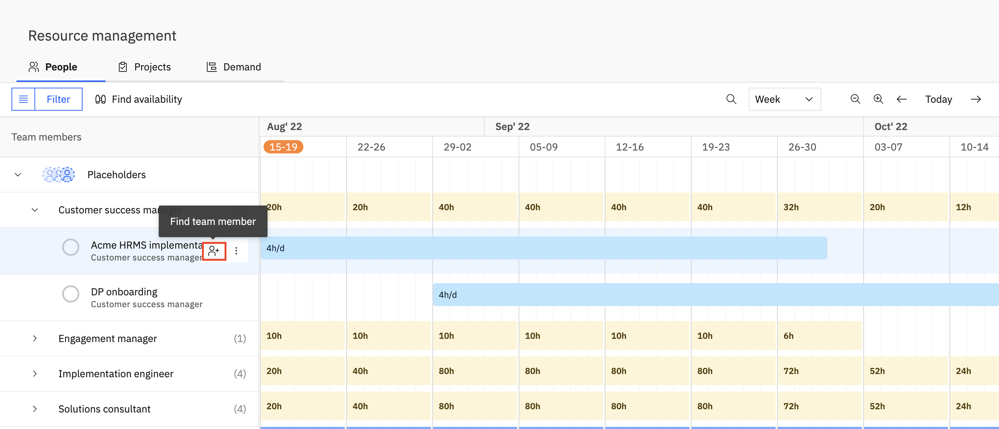**

Th&#x65;__&#xA0;'____Find team member'__ icon next to each project name under a __Placeholder__ helps you to find and allocate a __Team member__ based on their __Role__ and availability. \
\
The team member that you select will replace the placeholder.\
\
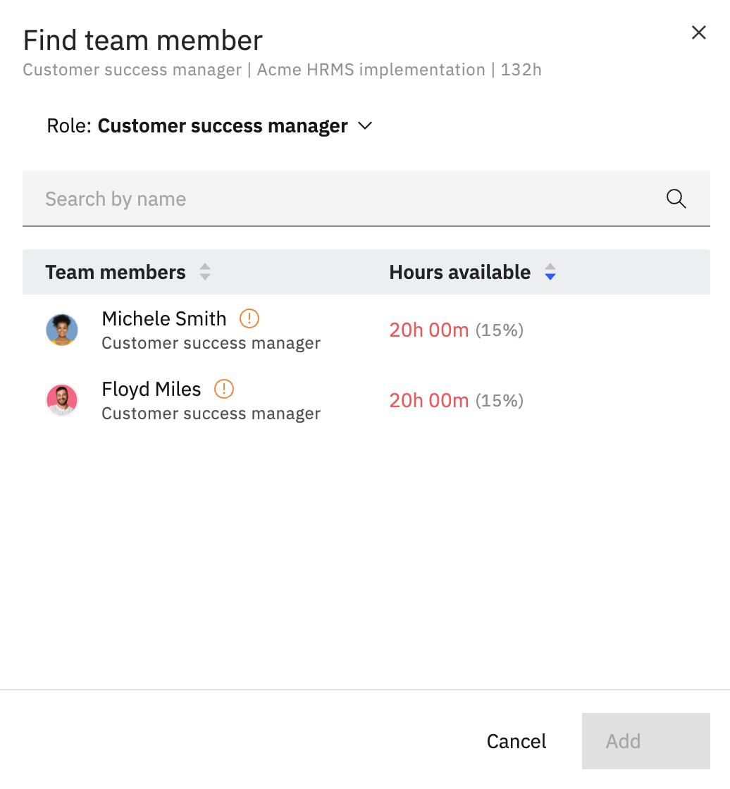

The '__Find team member'__ dialog box opens which lists all the __team members__ in the __role__ with their availability mentioned.

You can select a __role__ or search by the __team member's__ name too. Click on the __team member__ to select and click __Add__.\
\
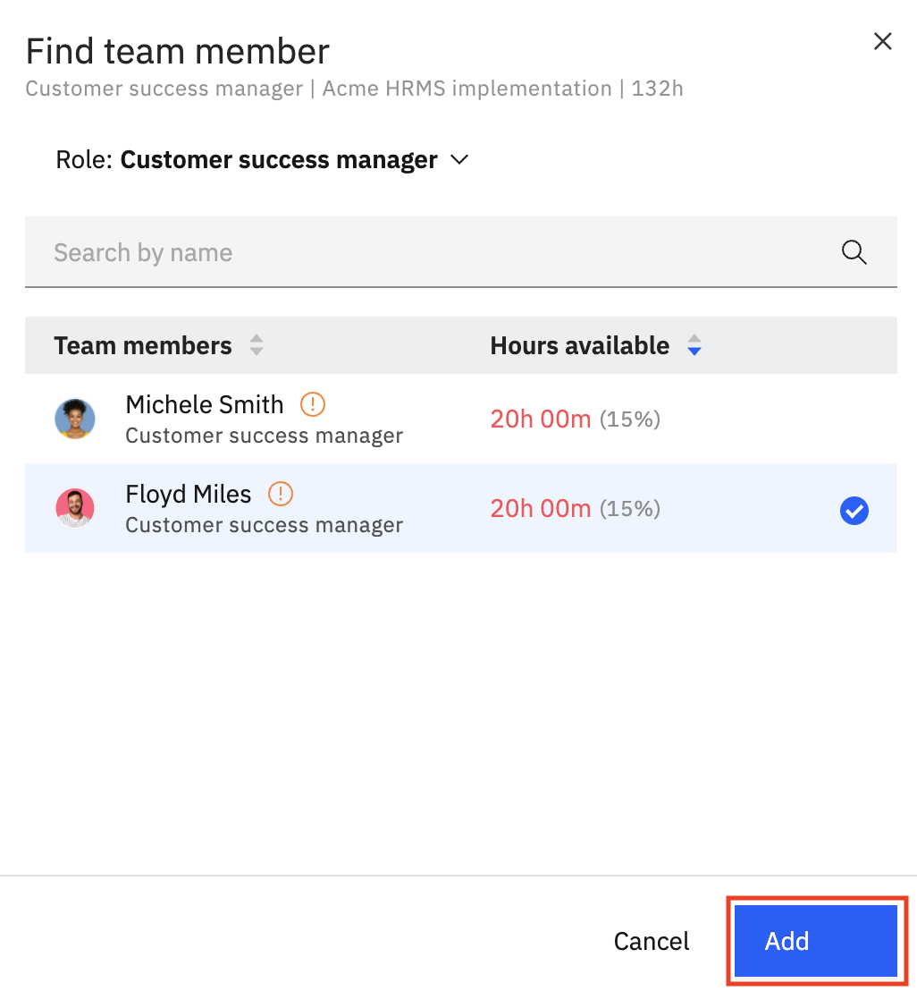\
\
The __placeholder__ will be replaced by the selected __team member's__ name.

**More Actions for Placeholders**

**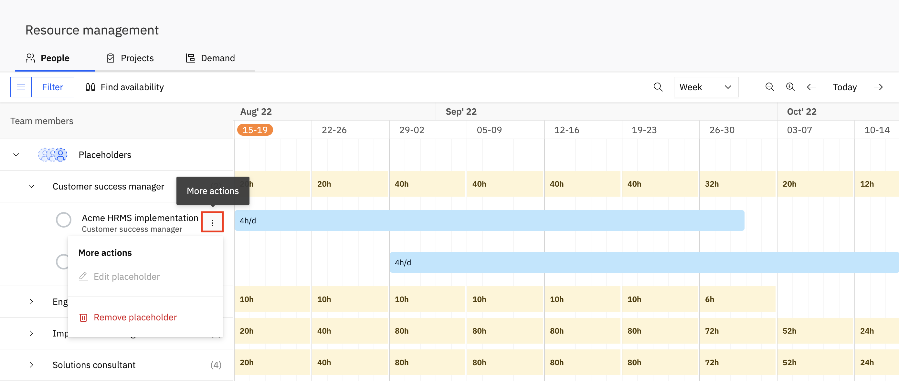**

**Edit placeholder**\
\
__'Edit placeholder'&#xA0;__&#x61;llows you to change the __placeholder__ name. \
\
__**Note:**__ This option is disabled for the default __placeholders__.

**Remove Placeholder**

The '__Remove placeholder'__ option allows you to remove the __placeholder__ from your __account__.\
\
\
To read more about how to effectively manage your team's capacity, click [here.](https://help.rocketlane.com/en/support/solutions/articles/67000704603)

 

Hey! Here's hoping that this support document was useful. You can write to us at [care@rocketlane.com](mailto:care@rocketlane.com) in case of any queries.
