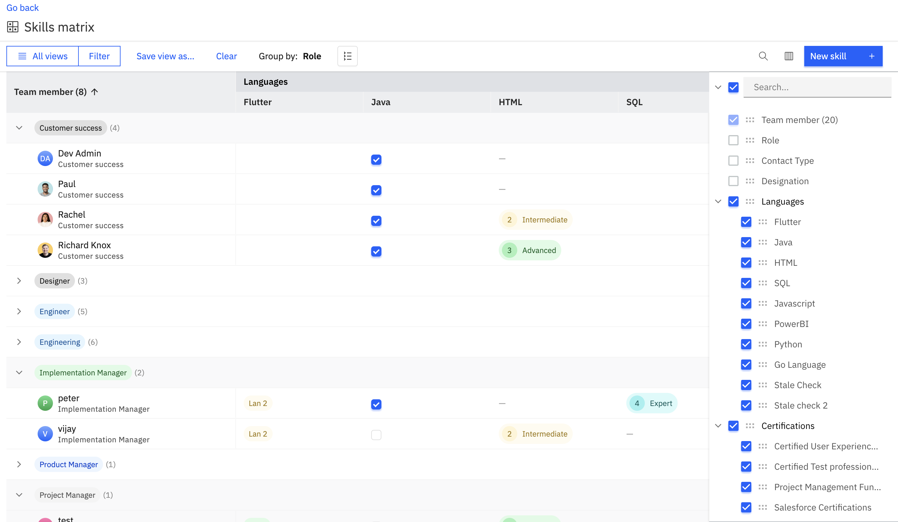

Imagine having access to a central hub where you can easily see your team members' skills, assess how good they are at each skill, and use this information to assign the right people to the right projects. If that sounds exciting, we have great news for you! Rocketlane has introduced the Skills Matrix feature, aimed at enabling your organization with streamlined skills management, ensuring your teams are equipped to tackle any challenge head-on. 

**In this article**

- [Skill types](#Skill-types)

- [Add skills to a library:](#Add-skills-to-a-library%3A)

- [Manage your skills matrix](#Manage-your-skills-matrix)

  - [Effortless Grouping by Roles and Skills:](#Effortless-Grouping-by-Roles-and-Skills%3A)
  - [Assign skills in skills matrix](#Assign-skills-in-skills-matrix)
  - [Customize Your View for Optimal Insights:](#Customize-Your-View-for-Optimal-Insights%3A)
  - [Advanced filtering of skills to refine search:](#Advanced-filtering-of-skills-to-refine-search%3A)

- [Assign skills to team members](#Assign-skills-to-team-members)

- [Match Skills to Projects with Ease](#Match-Skills-to-Projects-with-Ease)

  - [Under people tab](#Under-people-tab)
  - [Under projects tab](#Under-projects-tab)
  - [Under Resource AI](#Under-Resource-AI)

With the Skills Matrix, you can effortlessly view a curated list of your team members along with their specific skills and proficiency levels. By mapping team members to their respective skills and rating their proficiency, you can swiftly locate the perfect match for a project requiring specific skills and expertise. This feature provides you with a professional edge in managing your team's skills and ensuring project success.

In this article, we will delve into how to set up your Skills matrix, access the information, and assign the right people with the right skills to projects.

##

## Skill types

Each skill's proficiency can be evaluated using a skill type. Various skill types are linked to each skill. For instance, if someone possesses a skill in managing BI tools, their proficiency level can be indicated to reflect their expertise. This can be represented through a rating system or a proficiency level, such as beginner, intermediate, or expert.

|                 |                                                                        |                                                                                                             |
| --------------- | ---------------------------------------------------------------------- | ----------------------------------------------------------------------------------------------------------- |
| Yes/No          | A binary field that lets you choose if the person has the skill or not | Example: US Visa                                                                                            |
| Number          | Lets users add numbers like ratings from 1 to 10                       | Example: Scores in exams like PMP, Microsoft                                                                |
| Level           | Lets users define the skill competency                                 | Example: Language proficiency like Basic, Intermediate, Advanced, Fluent, Native or Near-Native Proficiency |
| Single choice   | Lets users one option from multiple choices                            | Example: Primary Programming Language Proficiency like Java, Python, Ruby etc                               |
| Multiple choice | Lets users select as many relevant options from the available choices  | Example: Software expertise like Salesforce, Tableau etc                                                    |

 

## Add skills to a library:

Skills matrix enables you to create a list of essential skills that your team members must possess to succeed in your projects. Additionally, you can specify the level of proficiency required for each skill, giving you the ability to align your team's capabilities precisely with your project requirements.

To add a skill,

- Go to your avatar and select "**Settings**." Scroll down to the "**Fields**" section.

- Here, you can begin adding skills and organizing them into sections.

- **Let's use an example: If your company provides consultancy services and requires expertise in BI tools, add this as a skill.**

- **If you're categorizing skills into sections like "soft skills," "technical skills," etc., start by creating a new section.**

- **Click the "****New section****" button and name your section. Save it by clicking the green checkmark.**

- **To add a new skill, click "****New skill****." Name the skill and select the skill type from the dropdown menu. For a skill type like "level," you can define competency levels when assigning the skill to team members. Similarly, other skill types allow you to specify proficiency levels.**

- **Place the skill into a section and provide a description if needed.**

- **Associate the skill with one or more roles or map it to all team members.**

- **Save the skill by clicking the "****Save****" button.**

**\&#xA;**

**[Watch video](https://fast.wistia.net/embed/iframe/2bmvbghhry?videoFoam=true)\&#xA;**

## **Manage your skills matrix**

**\&#xA;**

**The Skills Matrix serves as a repository, offering a comprehensive view of each team member's proficiencies across all their skills.&#xA0;**

**\&#xA;**

### **Effortless Grouping by Roles and Skills:**

**\&#xA;**

**Navigate through the skills matrix with ease by grouping team members according to roles and skills. By doing so, you'll gain a holistic understanding of the skill sets prevalent within each role, as well as identify individuals possessing specific skills crucial for your projects.**

**\&#xA;**

### **Assign skills in the skills matrix**

**Easily assign skills to team members and define their proficiency levels within the skills matrix. Furthermore, we'll explore additional methods for updating a team member's skills in the following sections.**

**\&#xA;**

**[Watch video](https://fast.wistia.net/embed/iframe/6ktspg4h4q?videoFoam=true)\&#xA;**

**\&#xA;**

### **Customize Your View for Optimal Insights:**

**\&#xA;**

**Tailor your Skills Matrix to suit your preferences by organizing skill columns. Utilize the column icon to remove or reorder skills represented as columns, ensuring you focus on the most relevant data. This flexibility empowers you to extract actionable insights like evaluating your team members’ skill sets for projects efficiently.**

**\&#xA;**

**[Watch video](https://fast.wistia.net/embed/iframe/6ktspg4h4q?videoFoam=true)\&#xA;**

**\&#xA;**

### **Advanced filtering of skills to refine search:**

**\&#xA;**

**Leverage the advanced skills filter feature to refine your team member search based on multiple skills and proficiency levels. By combining this with the team member fields filter such as region and role, you can precisely pinpoint individuals who meet the specific requirements of your projects. This streamlined approach ensures you assemble the ideal team for every project that is in the pipeline and is ongoing.**

**\&#xA;**

**Consider this example:**

**\&#xA;**

**Suppose you need a Developer proficient in JavaScript from the US region for your project. Simply add these specific skills and fields to the filter, and you will instantly see all the team members who meet these criteria.**

**\&#xA;**

**<Frame>
  
</Frame>\&#xA;**

**\&#xA;**

## **Assign skills to team members**

**\&#xA;**

**When inviting a team member and setting up their profile,&#xA0;**

**\&#xA;**

- **You'll have the option to add skills directly to their profile.**

- **Upon assigning a role to the user, all associated skills with that role will automatically appear.**

- **You can then easily map the skills that the user possesses to their profile.**

**\&#xA;**

**This feature provides a seamless way to ensure that the team member's profile is enriched with accurate information as they join Rocketlane.**

**\&#xA;**

**Note: You can also edit an existing team member's profile and add skills to their profile.**

**\&#xA;**

**[Watch video](https://fast.wistia.net/embed/iframe/azvso9x0w6?videoFoam=true)\&#xA;**

**\&#xA;**

## **Match Skills to Projects with Ease**

**In Resource Management, you can now find team members with the right skill sets with just a click of a button.**

**\&#xA;**

**For example:**

**\&#xA;**

**Suppose you need a Developer proficient in JavaScript from the US region for your project. Simply add these specific skills and fields to the filter, and you will instantly see all the team members who meet these criteria.**

### **&#x20;**

### **Under people tab**

**To locate a team member available within a specific time frame, follow these steps:**

**\&#xA;**

- **Navigate to&#xA0;****R****esource management****&#xA0;and choose the "****P****eople****" tab.**

- **Click the "****find availability****" button to view team members' availability over a specific period.**

- **Utilize skills filters in addition to roles to refine your search for team members.**

- **Click "****add skills/fields****" and apply the skills filter along with team member filters.**

- **Click "****find****" to display all team members matching the specified conditions.**

- **Select the desired team members and allocate projects to them."**

**\&#xA;**

**[Watch video](https://fast.wistia.net/embed/iframe/lsdn41ikzd?videoFoam=true)\&#xA;**

### **Under projects tab**

**To locate team members with the appropriate skills and proficiency for projects with role based placeholders follow these steps:**

**\&#xA;**

- **Navigate to****&#xA0;Resource management****&#xA0;and choose the "****Project****" tab.**

- **Click to expand a project to view its placeholders and select a placeholder for which you need a team member**

- **Near the placeholder, click the&#xA0;****Find team member****&#xA0;button**

- **Utilize****&#xA0;filters****&#xA0;to refine your search for team members with suitable skills.**

- **Click&#xA0;****done****&#xA0;and add team members to the project.**

**\&#xA;**

**[Watch video](https://fast.wistia.net/embed/iframe/rahhkcwhyp?videoFoam=true)\&#xA;**

**\&#xA;**

**\&#xA;**

### **Under Resource AI**

**\&#xA;**

**Rocketlane's Resource AI can simplify the process of building the right team for your project. By leveraging the power of AI, Resource AI can help you assemble a team of skilled professionals best suited to meet your project requirements. Furthermore, you can now add skills directly to the allocated placeholders in Resource AI, making it possible to create a team with the necessary skills for success.**

**[Watch video](https://fast.wistia.net/embed/iframe/5jrxtle2vu?videoFoam=true)**
